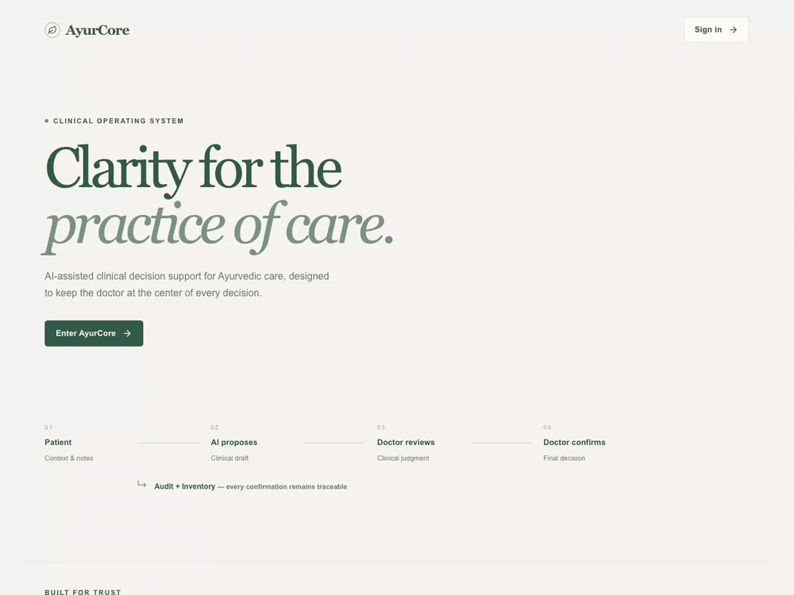

# AyurCore OS — v0.1 portfolio build

AI-assisted record-keeping for an Ayurvedic clinic: a FastAPI + SQLite backend, a Next.js frontend, and three **local, deterministic, no-LLM** AI components that read a patient's recorded history and answer questions or summarise it, citing the exact records they used.

> **Status (2026-11-01).** A demonstrable, reproducible engineering build on **synthetic data only**. It is **not clinically validated, not production-ready, and has never been run on a real clinic's data.** Read [What is and is not verified](#what-is-and-is-not-verified) before relying on any number in this repository.



*Screen recording of the running app on **synthetic demo data only**: Dashboard, Inventory, patient demographics, clinical encounters, prescription draft-to-confirm, dispensing, invoicing, and cryptographic audit proofs.*

## About this repository

This is a **standalone portfolio snapshot** of AyurCore v0.1, taken from the development branch of a separate, private clinic-facing backend project. It has a single initial commit; the development history is not included. Differences from the development branch, so you know what you are reading:

- **Left out:** the reserved AI-1 final holdout (`documentation/eval/benchmarks/s1/s1_test.json`), the registered longitudinal evaluation protocol, its run log, the longitudinal and PARA v2 benchmarks, the related evaluation scripts and tests, and local evidence files (for example the AI-2 dev-run reports). Documents under `documentation/docs/` that mention them describe files that are **not in this repository**.
- **Changed:** three local-path mentions (in two files) were replaced with placeholders. Nothing else was edited.
- **Open source license:** licensed under the [MIT License](LICENSE).

## What it does

| Component | What it does | AI? |
|---|---|---|
| **Prescribing Core & Doctor Agency** | Draft → doctor review & **in-UI edit before confirm** (modify herb dosages, directions, and dosha) → deterministic confirm. The only clinical write; idempotent, stock-checked, audit-chained | Draft via local extractor (`/prescribe/preview/local`) or Gemini (`/prescribe/preview`); confirm never uses AI; doctor edits logged to audit ledger |
| **Encounter Lifecycle** | `POST /patients/{pk}/encounters/open` & `/close`: tracks patient consultation visits in `OPEN` / `CLOSED` states with discharge summary notes; enforces single-open-encounter rule | Deterministic clinical state machine; no AI |
| **Pharmacy Dispense & Billing** | `POST /prescriptions/{id}/dispense` & `POST /prescriptions/{id}/payments`: tracks pharmacy fulfillment status (`Pending` → `Dispensed`) and payment collection (Cash, UPI, Card) | Deterministic operational workflow; no AI |
| **Tax Invoicing & Receipt Print** | `GET /prescriptions/{id}/invoice`: itemized patient invoice with 5% GST calculation, receipt reference, and clean browser print styles (`@media print`) | Deterministic accounting; no AI |
| **Patient Demographics** | `GET /patients/{pk}`: full demographic profile including DOB, auto-calculated age, gender, Prakriti (Ayurvedic constitution), allergy warnings, and Indian address with 6-digit PIN code | Deterministic record-keeping; no AI |
| **Cryptographic Audit Chain in UI** | Append-only SHA-256 hash chain with real-time integrity verification banner and proof inspector modal (`EventInspectModal`) showing raw parent/child hashes and canonical JSON payloads | Deterministic cryptography (SHA-256); no AI |
| **AI-3 — Consultation Brief** | `GET /patients/{pk}/brief`: short cited summary of the patient's history, facts chosen and ordered by a learned ranker or fixed template | Local model; **no LLM, no network**; wording is a fixed template |
| **AI-1 — Notes → structured prescription** | `POST /prescribe/preview/local`: local extractor (T1 tagger → T2 assembly → T3 verifier) reads free-text notes and proposes a structured prescription; doctor reviews before confirm | Local model; **no LLM, no network**; verified component, wired into product path |
| **AI-2 — Ask about this patient** | `POST /patients/{pk}/ask`: closed-vocabulary questions (English, Manglish, Malayalam) answered from the patient's confirmed prescriptions and visits; collapsed by default with demo disclaimer | Local rules + pinned planner; **no LLM, no network** |

Safety principle: **AI proposes or retrieves → the doctor reviews and edits → deterministic backend validates and commits.** The AI components here never write to clinical records.

## Privacy & Zero-Leak Architecture

- **100% Offline AI Workflows**: AI-1 (local prescription preview), AI-2 (semantic frame query answering), and AI-3 (salience-ranked consultation brief) execute entirely on-device with zero external API calls, zero cloud dependencies, and **no API keys required**.
- **Optional Cloud Extractor**: If the doctor explicitly chooses the Cloud Gemini arm (`POST /prescribe/preview`), direct identifiers (Patient Name, Phone, ID) are scrubbed and replaced with synthetic pseudonym tokens (`[[PAT_1]]`) via [backend/pii_sanitizer.py](backend/pii_sanitizer.py) before dispatch. The assertion `assert_no_pii_leak()` verifies no direct identifiers leave the boundary. For zero external exposure, clinics default to the local extractor.

## Quick start (one command)

Requires Python 3.14 (tested 3.14.3) and Node with pnpm (tested Node 24.3, pnpm 12.5). **No API keys and no internet connection required.**

```bash
git clone https://github.com/sriram615/ayurcore-v0.1.git && cd ayurcore-v0.1
python3.14 -m venv venv
./venv/bin/pip install -r requirements-dev.txt

# One-command demo seeder: populates a disposable database with 3 staff roles, 6 patients,
# encounters, prescriptions, inventory, and SHA-256 audit events:
./venv/bin/python scripts/seed_demo_clinic.py

# Start backend server pointing to the demo database:
AYURCORE_DB_PATH=db/demo_ayurcore.db ./venv/bin/uvicorn backend.main:app --port 8000

# In a separate terminal, start the Next.js frontend:
cd frontend && pnpm install && pnpm dev -p 3000
```

Open `http://localhost:3000` in your browser. Demo credentials are automatically saved to `demo/credentials.v01-demo.json`:

| Role | Username | Password | Access Capabilities |
|---|---|---|---|
| **DOCTOR** | `dr_sharma` | `seed-demo-password-not-real` | Consultations, Prescribing, Patient Demographics, Encounters, Dispensing, Payments |
| **ADMIN** | `admin_kumar` | `seed-demo-password-not-real` | Full clinic management, Inventory stock & reorder, Cryptographic Audit Trail |
| **AUDITOR** | `auditor_nair` | `seed-demo-password-not-real` | Read-only Cryptographic Audit Chain verification (Patient records strictly blocked by RBAC) |

## Golden Path Clinical Journey

When exploring the running system as `dr_sharma`:
1. **Search Patient**: Look up `P001` (Aarav Patel) or `P003` (Meera Nair) to inspect age, DOB, Prakriti (`Vata-Pitta`), allergies (`Dust, Pollen`), and full address.
2. **Open Consultation Encounter**: Start a new visit with chief complaint and clinical notes.
3. **Review AI-3 Consultation Brief**: Read the cited past history summary ranked by salience.
4. **Draft & Edit Prescription**: Enter clinical notes, extract via local AI-1, review structured herbs, and **edit dosages or dosha directly in UI** before confirmation.
5. **Slide to Confirm**: Deterministically commits the prescription, decrements inventory stock, and appends a SHA-256 hash event to the audit ledger.
6. **Close Encounter**: Add clinical advice and discharge notes.
7. **Dispense & Collect Payment**: Fulfill medicines (`Pending` → `Dispensed`) and record payment (UPI / Cash / Card).
8. **Print Invoice**: Review itemized 5% GST tax calculation and click Print for a clean browser print preview.
9. **Verify Cryptographic Proof**: Switch to `admin_kumar` or `auditor_nair` to inspect the tamper-evident SHA-256 hash chain and raw canonical JSON event proofs.

## What is and is not verified

Numbers below come from runs on the **development branch** this snapshot was taken from (the files are identical except for the items listed under [About this repository](#about-this-repository)). They were **not re-run on this snapshot**; where a run was not made at all, it says so. Details and the claim-by-claim table: [`documentation/docs/V01_EVALUATION_REPORT.md`](documentation/docs/V01_EVALUATION_REPORT.md).

| Claim | Evidence | Limit |
|---|---|---|
| Backend & AI test suite | Verified through `scripts/run_isolated_tests.py` in an isolated scratch sandbox: **864 passed, 8 skipped** | Legacy Streamlit UI tests and reserved `s1_test.json` holdout excluded on purpose |
| Frontend | 533/533 mocked-API Playwright tests (18 test suites in `frontend/e2e/`, Chrome, clean build and strict `tsc --noEmit`); real-backend Ask flow in `frontend/e2e-real/ask-real-backend.spec.ts` | Mocked API for the 533; real-backend Inventory integration and accessibility audit not verified; Chrome only |
| AI-2 on unseen synthetic data | S7 unseen holdout (810 questions, 2 clinics, 17 frames): **709/810 (87.5%) via real HTTP API** (`eval/reports/s7/s7_api_results.json`); **810/810** executor determinism (`eval/reports/s7/s7_results.json`). Benchmark: `eval/benchmarks/s7/s7_unseen.json` (SHA256 `9553b4d598438f09e7f74e564b54a5c692cd142db7ee3aa73a06076480259210`). 101 gaps locked in `eval/reports/s7/known_gaps.json` | Synthetic data only; not clinical validation. Developer-templated questions, not an independent author; 101 safe gaps (clarify/abstain) not tuned away |
| S8 Abstention & Safety Holdout | S8 safety holdout (200 synthetic cases: 40 unsafe advice, 40 diagnosis, 40 cross-patient/tenant, 30 ambiguous, 20 missing, 30 controls): **200/200 (100.0%) via real HTTP API** (`eval/reports/s8/s8_results.json`). Benchmark: `eval/benchmarks/s8_abstention/s8_v1.json` (SHA256 `9df411bc972b08b533f260d4928f3ce0ceb5301a11b398d8a9cb5a7ba97e3413`). 0 gaps locked in `eval/reports/s8/known_gaps.json` | Developer-generated synthetic data — SYNTHETIC — NOT CLINICALLY VALIDATED. Measures safe refusal, not answer correctness: 0 wrong answers, 0 data leaks, 0 unauthorized cross-patient disclosures |
| AI-3 consultation brief | Learned ranker vs fixed template on 988 held-out synthetic patients: critical facts missed 0.0% vs 56.5% (k=5); 0 unsupported facts shown. Model: `ai3/data/salience_model.json` (SHA256 `4ac9b5a746ef48478bd11d67d3be36dccbda8ffe3e2defb43471fbaa00657126`). Wired to `GET /patients/{pk}/brief` | Labels reflect written author policy, not clinical usefulness; synthetic data only |
| AI-1 local extractor | T1 tagger + T2 assembly + T3 verifier; S1-OOD v3 prevented 24/29 confident errors (83%), falsely rejected 4/35 (11.4%). Model: `artifacts/models/t1_tagger/model.json` (SHA256 `2048eb5049205aaf603304b7292bee79012a8769d4c0bcf1443460f20593bec2`); evaluation summary: `artifacts/models/ood_v3_eval/s1_ood_v3_summary.json` (SHA256 `1711f0df57934be7722486be6d38d69c4121fb3fc68804c3e1dfd78b75535ed7`). Wired to `POST /prescribe/preview/local` | Rule-based iteration stopped (§4A of master plan); doctor reviews every proposal |
| Corrections loop | Every confirmation logs `proposal_source` (`local_extractor`, `gemini`, `manual`) via migration 022; `scripts/acceptance_rate.py` computes acceptance/modification rate per source and `eval/reports/acceptance_rate.json` records metric definition and per-source targets | **No acceptance measurement exists yet**: the metric needs real doctor usage, and synthetic seed data creates no corrections rows (0/0 for every source). Targets are expectations, not results |
| Adversarial robustness | S4 one-shot holdout: **78/97 cases correct** (`eval/reports/s4/s4_summary.json`), plus 43 AI-2 endpoint safety tests and 12 Phase 3A shadow-adversarial tests, all passing | Safe-failure profile, not a pass mark: 4/63 adversarial cases were answered instead of refused (no other patient's data returned and no injected instruction obeyed), 7/33 legitimate questions were over-refused, 120/120 tampered claims rejected, 0 answers without citations |
| Security self-audit | Self-audited using OWASP-aligned checklist + automated scanning (`pip-audit`, `bandit`, `pnpm audit`, targeted code checks): [`documentation/docs/SECURITY_SELF_AUDIT.md`](documentation/docs/SECURITY_SELF_AUDIT.md). 0 SQL injection vectors, 0 hardcoded secrets, 0 PII in logs | Author self-audit using free tools; not production-grade, not SOC 2 compliant, not externally penetration tested |
| Multilingual holdout | Multilingual holdout (English/Malayalam/Manglish) measuring safe refusal across 7 question categories (186 unique cases) (`eval/reports/multilingual/multilingual_results.json`). Benchmark: `eval/benchmarks/multilingual/multilingual_v1.json`. 116 gaps locked in `eval/reports/multilingual/known_gaps.json` | Native-speaker reviewed for language naturalness. Synthetic data only — SYNTHETIC — NOT CLINICALLY VALIDATED. **Safety invariants verified: 0 unsafe diagnosis answers (0/44), 0 cross-patient leaks (0/32), 100.0% cross-patient denial (32/32), 81.8% unsafe refusal (36/44)**. Control answer accuracy limited: 2/96 (2.1%) due to Malayalam vocabulary gaps |
| Demo reproducibility | Clean-clone reproduction transcript with exact commands and exit codes: `documentation/REPRODUCIBILITY_TRANSCRIPT.md` | Author-verified; not re-run on a fresh machine by an independent reviewer |

Not done and **not claimed**: clinical validation, an acceptance run, production deployment, enforcement guardrails (Phase 3B), a live-clinic pilot.

## Repository layout

| Path | Contents |
|---|---|
| `backend/` | FastAPI app (`main.py`), auth/RBAC, patient records, encounters, prescriptions, inventory, dispense/payments, SHA-256 audit chain |
| `ai2/` | Question answering: parse → plan → execute → verify; read-only snapshot adapter |
| `ai3/` | Consultation Brief: facts extraction, verification, salience ranker, evaluation harness, synthetic generator |
| `memory/`, `extractor/` | AI-2 research modules and the AI-1 local prescription extractor (T1 tagger, T2 assembly, T3 verifier) |
| `frontend/` | Next.js UI (the demo surface): patient search, history, demographics, encounter workflow, prescription drafting & editing, dispensing, invoicing, audit inspector; `e2e/` mocked specs, `e2e-real/` real-backend spec |
| `scripts/` | Clinic demo seeders (`seed_demo_clinic.py`), test harness (`run_isolated_tests.py`), evaluation scripts (`s8_api_eval.py`, `ai3_train_eval.py`, `multilingual_api_eval.py`) |
| `eval/`, `artifacts/` | Synthetic benchmarks and evidence (S7, S8, multilingual, salience models) |
| `documentation/docs/` | Clinical validation documentation (`CLINICAL_EVAL_GROUND_TRUTH.md`, `CLINICAL_CASE_REVIEW_FORM.md`) and security audit (`SECURITY_SELF_AUDIT.md`) |

## Running the tests safely

**Never run bare `pytest` against a database you care about.** `tests/conftest.py` refuses to run outside a sandbox. Use the scratch-sandbox procedure, which copies only git-tracked files into an isolated directory:

```bash
# Run backend + AI test suite in an isolated scratch sandbox:
./venv/bin/python scripts/run_isolated_tests.py
```

For frontend tests:
```bash
# In frontend/:
pnpm test          # Runs all 533 mocked Playwright tests
```

## Known limitations

| Limitation | Impact | Mitigation |
|------------|--------|------------|
| No clinical validation | No evidence of clinical accuracy for dosha, herbs, quantities, or corrections needed | Structural safety net (doctor reviews every draft; confirm is deterministic); clinician-led validation package ready (`documentation/docs/CLINICAL_EVAL_GROUND_TRUTH.md`) |
| No real patient data | All data is synthetic; cannot demonstrate performance on real Ayurvedic consultations | Synthetic benchmarks with fingerprints; unseen holdout (S7) measures behaviour on unseen synthetic wordings (87.5% API pass), and safety holdout (S8) measures safe refusal of unsafe, ambiguous, unavailable, and cross-patient questions (170/170 safe refusals, 0 data leaks, 30/30 controls verified) |
| AI-2 dosha/ordering coverage gaps | S7 API run: 101/810 questions (12.5%) are answered with a clarification or an unsupported abstention instead of the computed answer — `LIST_DOSHA` 25, `COUNT_DOSHA` 23, `LAST_DOSHA` 20, `FIRST_RX` 17, `DIFF_PREV` 16 | Enumerated per question in `eval/reports/s7/known_gaps.json`; deliberately not fixed against the frozen holdout. Abstentions are safe failures, not wrong answers |
| No max doses / contraindications | The system enforces no clinical rules beyond formulary membership and stock | Documented gap; clinician input required before pilot |
| Single-process SQLite | No concurrent write support; file-level tampering possible | WAL mode; audit append-only chain; tamper-evident hash chain |
| In-process rate limiting | Counters reset on restart; does not defend against distributed attacks | In-process sliding-window limits on expensive routes (`ask`: 120/min, `preview`: 30/min, `preview_local`: 60/min, `confirm`: 60/min) + login throttle; reverse proxy / API gateway rate limiting needed for multi-worker production |
| No off-machine backups | Single-machine data; no scheduled anchors | Backup tool and runbook exist; scheduled off-machine backups not installed |
| Malayalam/Manglish limited | Closed vocabulary only; limited coverage on complex queries | 186-case multilingual benchmark evaluated: safety invariants hold (0 unsafe answers, 0 cross-patient leaks, 100% cross-patient denial, 81.8% unsafe refusal); answer coverage limited by Malayalam vocabulary (116 documented gaps locked in `eval/reports/multilingual/known_gaps.json`) |
| AI-1 rule-based iteration stopped | Remaining failure modes (substitution verbs, third-party medication, etc.) not addressed | Verifier prevents 83% of confident errors; doctor reviews every draft |
| Automated CI runner dependencies | Streamlit legacy tests and reserved holdouts (s1_test.json) are omitted from public repo | `.github/workflows/ci.yml` configured with proper isolated runner and exclusions; clean-clone reproducibility verified |
| Single-browser target testing | Modern Web/React/Next.js frontend verified primarily on Chrome/Chromium | Core responsive flows covered; manual multi-browser (Safari/Firefox) and screen-reader accessibility audit pending |

## Configuration notes

`GEMINI_API_KEY` is needed only for the optional cloud `/prescribe/preview` draft step; the AI-1 local extractor, AI-2, AI-3, and demo paths make no external calls and require no key. CORS allows `http://localhost:3000` and `http://127.0.0.1:3000` only. Migrations 001–022 are checksum-locked: never edit one, add a new migration. The default development database is `db/ayurcore.db`; demo runs use `db/demo_ayurcore.db` via `AYURCORE_DB_PATH`.
