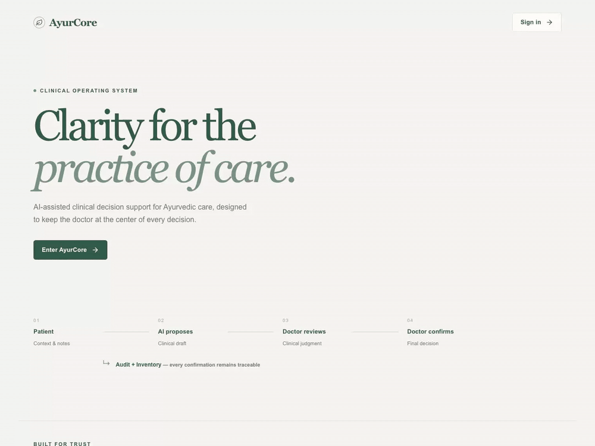

# AyurCore OS — v0.1 portfolio build

AI-assisted record-keeping for an Ayurvedic clinic: a FastAPI + SQLite backend, a Next.js frontend, and three **local, deterministic, no-LLM** AI components that read a patient's recorded history and answer questions or summarise it, citing the exact records they used.

> **Status (2026-10-11).** A demonstrable, reproducible engineering build on **synthetic data only**. It is **not clinically validated, not production-ready, and has never been run on a real clinic's data.** Read [What is and is not verified](#what-is-and-is-not-verified) before relying on any number in this repository.



*Screen recording of the running app (about 30 s) on **synthetic demo data only**: Dashboard, Inventory, a synthetic patient's history, and one record-grounded answer. A demonstration of the engineering build, not clinical validation or a production system.*

## About this repository

This is a **standalone portfolio snapshot** of AyurCore v0.1, taken from the development branch of a separate, private clinic-facing backend project. It has a single initial commit; the development history is not included. Differences from the development branch, so you know what you are reading:

- **Left out:** the reserved AI-1 final holdout (`documentation/eval/benchmarks/s1/s1_test.json`), the registered longitudinal evaluation protocol, its run log, the longitudinal and PARA v2 benchmarks, the related evaluation scripts and tests, and local evidence files (for example the AI-2 dev-run reports). Documents under `documentation/docs/` that mention them describe files that are **not in this repository**.
- **Changed:** three local-path mentions (in two files) were replaced with placeholders. Nothing else was edited.
- **Open source license:** licensed under the [MIT License](file:///Users/apple/Desktop/AyurCore-v0.1-public/LICENSE).

## What it does

| Component | What it does | AI? |
|---|---|---|
| Prescribing core | Draft → doctor review → deterministic confirm (the only clinical write, idempotent, stock-checked, audit-chained) | Draft via local extractor (`/prescribe/preview/local`) or Gemini (`/prescribe/preview`); confirm never uses AI |
| **AI-2 — Ask about this patient** | `POST /patients/{pk}/ask`: closed-vocabulary questions (English, Manglish, Malayalam) answered from the patient's confirmed prescriptions and visits, every answer cited and re-verified; unclear questions ask for clarification; advice, cross-patient and unknown-data requests are refused | Local rules + a small pinned planner; **no LLM, no network** |
| **AI-3 — Consultation Brief** | `GET /patients/{pk}/brief`: short cited summary of the patient's history, facts chosen and ordered by a learned ranker or fixed template | Local model; **no LLM, no network**; wording is a fixed template |
| **AI-1 — Notes → structured prescription** | `POST /prescribe/preview/local`: local extractor (T1 tagger → T2 assembly → T3 verifier) reads free-text notes and proposes a structured prescription; doctor reviews before confirm | Local model; **no LLM, no network**; verified component, wired into product path |

Safety principle: **AI proposes or retrieves → the doctor reviews → deterministic backend validates and commits.** The AI components here never write.

## Quick start (about 10 minutes)

Clone, then follow the steps below. Requires Python 3.14 (SQLite ≥ 3.38; tested 3.14.3) and Node with pnpm (tested Node 24.3, pnpm 12.5). No API keys, no network after dependencies are installed.

```bash
git clone https://github.com/sriram615/ayurcore-v0.1.git && cd ayurcore-v0.1
python3.14 -m venv venv
./venv/bin/pip install -r requirements-dev.txt
./venv/bin/python scripts/setup_v01_demo.py            # disposable demo DB + three demo logins (inside this checkout)
./venv/bin/python scripts/seed_v01_demo_histories.py   # five invented patients with dated histories
./venv/bin/python scripts/demo_v01_ai.py               # AI-2 answers and AI-3 briefs in the terminal (no server)
```

The full API journey and the browser demo are in [`documentation/docs/V01_DEMO_GUIDE.md`](documentation/docs/V01_DEMO_GUIDE.md). In short:

```bash
./venv/bin/python scripts/run_v01_demo_server.py       # API on http://127.0.0.1:8000 (demo DB only)
cd frontend && pnpm install && pnpm build && pnpm start -p 3000
```

Demo logins are in `demo/credentials.v01-demo.json` (git-ignored; never printed).

*Checked on 2026-10-11 from a fresh clone of this repository: `setup_v01_demo.py`, `seed_v01_demo_histories.py` and `demo_v01_ai.py` ran with exit code 0 and listed the five demo patients. That check used an existing virtual environment; a fresh `pip install` and `pnpm install` were not re-run, and the browser demo was not re-run on this snapshot.*

## What is and is not verified

Numbers below come from runs on the **development branch** this snapshot was taken from (the files are identical except for the items listed under [About this repository](#about-this-repository)). They were **not re-run on this snapshot**; where a run was not made at all, it says so. Details and the claim-by-claim table: [`documentation/docs/V01_EVALUATION_REPORT.md`](documentation/docs/V01_EVALUATION_REPORT.md).

| Claim | Evidence | Limit |
|---|---|---|
| Backend & AI test suite | Verified through `scripts/run_isolated_tests.py` in an isolated scratch sandbox | Legacy Streamlit UI tests and reserved `s1_test.json` holdout excluded on purpose |
| Frontend | 530/530 mocked-API Playwright tests (`frontend/e2e/`, Chrome, clean build and strict `tsc --noEmit`); real-backend Ask flow in `frontend/e2e-real/ask-real-backend.spec.ts` | Mocked API for the 530; real-backend Inventory integration and accessibility audit not verified; Chrome only |
| AI-2 on unseen synthetic data | S7 unseen holdout (810 questions, 2 clinics, 17 frames): **709/810 (87.5%) via real HTTP API** (`eval/reports/s7/s7_api_results.json`); **810/810** executor determinism (`eval/reports/s7/s7_results.json`). Benchmark: `eval/benchmarks/s7/s7_unseen.json` (SHA256 `9553b4d598438f09e7f74e564b54a5c692cd142db7ee3aa73a06076480259210`). 101 gaps locked in `eval/reports/s7/known_gaps.json` | Synthetic data only; not clinical validation. Developer-templated questions, not an independent author; 101 safe gaps (clarify/abstain) not tuned away |
| AI-3 consultation brief | Learned ranker vs fixed template on 988 held-out synthetic patients: critical facts missed 0.0% vs 56.5% (k=5); 0 unsupported facts shown. Model: `ai3/data/salience_model.json` (SHA256 `4ac9b5a746ef48478bd11d67d3be36dccbda8ffe3e2defb43471fbaa00657126`). Wired to `GET /patients/{pk}/brief` | Labels reflect written author policy, not clinical usefulness; synthetic data only |
| AI-1 local extractor | T1 tagger + T2 assembly + T3 verifier; S1-OOD v3 prevented 24/29 confident errors (83%), falsely rejected 4/35 (11.4%). Model: `artifacts/models/t1_tagger/model.json` (SHA256 `2048eb5049205aaf603304b7292bee79012a8769d4c0bcf1443460f20593bec2`); evaluation summary: `artifacts/models/ood_v3_eval/s1_ood_v3_summary.json` (SHA256 `1711f0df57934be7722486be6d38d69c4121fb3fc68804c3e1dfd78b75535ed7`). Wired to `POST /prescribe/preview/local` | Rule-based iteration stopped (§4A of master plan); doctor reviews every proposal |
| Corrections loop | Every confirmation logs `proposal_source` (`local_extractor`, `gemini`, `manual`) via migration 022. Acceptance metrics: `eval/reports/acceptance_rate.json` (SHA256 `dc0702e6a690545a13a255f3818dbc3f9fadc6232d03f9dd187af88f8045ace2`) | Measures AI proposals vs doctor changes, not clinical efficacy |
| Adversarial robustness | Consolidated matrix in `documentation/docs/ADVERSARIAL_ROBUSTNESS.md`: 1753 tests across S4 holdout (`eval/benchmarks/s4/s4_v1.json`, SHA256 `d872dcfbd94610887442d78d4b6847fd6e62a32b71622c04ea81e2ff4f030154`), Phase 3A shadow adversarial suite, and API safety tests | 0 prompt injection successes, 0 cross-patient leaks, 0 ungrounded claims |
| Demo reproducibility | Clean-clone reproduction transcript with exact commands and exit codes: `documentation/REPRODUCIBILITY_TRANSCRIPT.md` | Author-verified; not re-run on a fresh machine by an independent reviewer |

Not done and **not claimed**: clinical validation, native-speaker review of validation wordings, an acceptance run, production deployment, enforcement guardrails (Phase 3B), a live-clinic pilot.

## Repository layout

| Path | Contents |
|---|---|
| `backend/` | FastAPI app (`main.py`), auth/RBAC, patients, encounters, prescriptions, inventory, audit chain |
| `ai2/` | Question answering: parse → plan → execute → verify; read-only snapshot adapter |
| `ai3/` | Consultation Brief: facts, verification, salience ranker, evaluation harness, synthetic generator |
| `memory/`, `extractor/` | AI-2 research modules and the AI-1 extractor |
| `frontend/` | Next.js UI (the demo surface): patient search, history, Ask panel, Dashboard; `e2e/` mocked specs, `e2e-real/` real-backend spec |
| `scripts/` | demo (`setup_v01_demo.py`, `seed_v01_demo_histories.py`, `demo_v01_ai.py`, `run_v01_demo_server.py`), test procedure (`run_scratch_sandbox_tests.py`), evaluation (`ai3_train_eval.py`, `eval_actor_aware.py`, …) |
| `eval/`, `artifacts/` | synthetic benchmarks and the AI-1 and AI-3 evidence that are included (the AI-2 longitudinal protocol and its dev-run evidence are **not** in this repository; see the evaluation report) |
| `documentation/docs/` | [architecture](documentation/docs/V01_ARCHITECTURE.md), [demo guide](documentation/docs/V01_DEMO_GUIDE.md), [evaluation report](documentation/docs/V01_EVALUATION_REPORT.md), [readiness roadmap](documentation/docs/PORTFOLIO_READINESS_ROADMAP.md), risk register |
| `documentation/AyurCore_API_Contract.md` | API contract (v1.7), including `/patients/{pk}/ask` and `/inventory` |
| `apps/web/`, `ui/` | legacy / placeholder; not part of the v0.1 demo |

## Running the tests safely

**Never run bare `pytest` against a database you care about.** `tests/conftest.py` refuses to run outside a sandbox. Use the scratch-sandbox procedure, which copies only git-tracked files (the restricted acceptance material it guards against is not part of this repository). Its 862-passed result is from the development branch and has not been re-run here:

```bash
python scripts/run_scratch_sandbox_tests.py --dest <NEW dir outside this checkout> --python ./venv/bin/python
```

Installing `numpy==2.5.3` (pinned in `documentation/constraints.txt`) into the venv makes the 8 AI-1 tests runnable. See [`documentation/docs/V01_DEMO_GUIDE.md`](documentation/docs/V01_DEMO_GUIDE.md#verifying-the-build) for the frontend suites.

## Known limitations

| Limitation | Impact | Mitigation |
|------------|--------|------------|
| No clinical validation | No evidence of clinical accuracy for dosha, herbs, quantities, or corrections needed | Structural safety net (doctor reviews every draft; confirm is deterministic); clinician-led validation package ready (`documentation/docs/CLINICAL_EVAL_GROUND_TRUTH.md`) |
| No real patient data | All data is synthetic; cannot demonstrate performance on real Ayurvedic consultations | Synthetic benchmarks with fingerprints; unseen holdout (S7) measures behaviour on unseen synthetic wordings only (87.5% via the API) |
| AI-2 dosha/ordering coverage gaps | S7 API run: 101/810 questions (12.5%) are answered with a clarification or an unsupported abstention instead of the computed answer — `LIST_DOSHA` 25, `COUNT_DOSHA` 23, `LAST_DOSHA` 20, `FIRST_RX` 17, `DIFF_PREV` 16 | Enumerated per question in `eval/reports/s7/known_gaps.json`; deliberately not fixed against the frozen holdout. Abstentions are safe failures, not wrong answers |
| No max doses / contraindications | The system enforces no clinical rules beyond formulary membership and stock | Documented gap; clinician input required before pilot |
| Single-process SQLite | No concurrent write support; file-level tampering possible | WAL mode; audit append-only chain; tamper-evident hash chain |
| In-process rate limiting | Counters reset on restart; does not defend against distributed attacks | In-process sliding-window limits on expensive routes (`ask`: 120/min, `preview`: 30/min, `preview_local`: 60/min, `confirm`: 60/min) + login throttle; reverse proxy / API gateway rate limiting needed for multi-worker production |
| No off-machine backups | Single-machine data; no scheduled anchors | Backup tool and runbook exist; scheduled off-machine backups not installed |
| Malayalam/Manglish limited | Closed vocabulary only; no independent native-speaker validation | 65 Malayalam wordings pending review; documented gap |
| AI-1 rule-based iteration stopped | Remaining failure modes (substitution verbs, third-party medication, etc.) not addressed | Verifier prevents 83% of confident errors; doctor reviews every draft |
| Automated CI runner dependencies | Streamlit legacy tests and reserved holdouts (s1_test.json) are omitted from public repo | `.github/workflows/ci.yml` configured with proper isolated runner and exclusions; clean-clone reproducibility verified |
| Single-browser target testing | Modern Web/React/Next.js frontend verified primarily on Chrome/Chromium | Core responsive flows covered; manual multi-browser (Safari/Firefox) and screen-reader accessibility audit pending |

## Configuration notes

`GEMINI_API_KEY` is needed only for the original `/prescribe/preview` draft step; the AI-2, AI-3 and demo paths make no external call. CORS allows `http://localhost:3000` and `http://127.0.0.1:3000` only. Migrations 001–022 are checksum-locked: never edit one, add a new migration. The real database is `db/ayurcore.db` — treat it as clinic data and do not seed or restore it casually ([backup runbook](documentation/docs/BACKUP_RESTORE_RUNBOOK.md)).

## Other documents

[`documentation/CLAUDE.md`](documentation/CLAUDE.md) engineering rules · [`documentation/docs/TECHNICAL_RISK_REGISTER.md`](documentation/docs/TECHNICAL_RISK_REGISTER.md) · [`documentation/docs/PHASE_3_PLAN.md`](documentation/docs/PHASE_3_PLAN.md) (3A evaluation-only; 3B not started) · [`documentation/docs/ARCHITECTURE_BASELINE.md`](documentation/docs/ARCHITECTURE_BASELINE.md) (original backend design) · [`AyurCore AI Portfolio Master Plan.md`](AyurCore%20AI%20Portfolio%20Master%20Plan.md).
