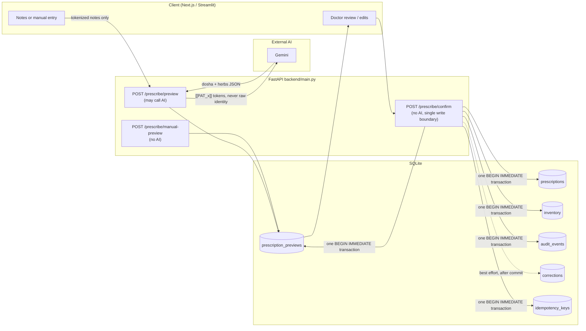
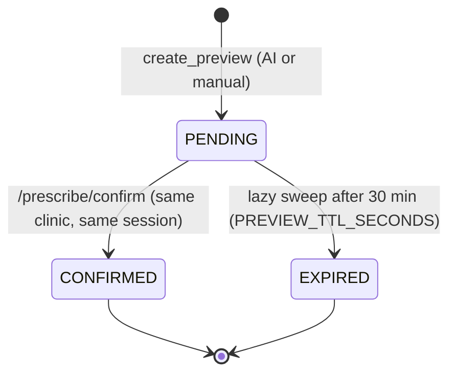
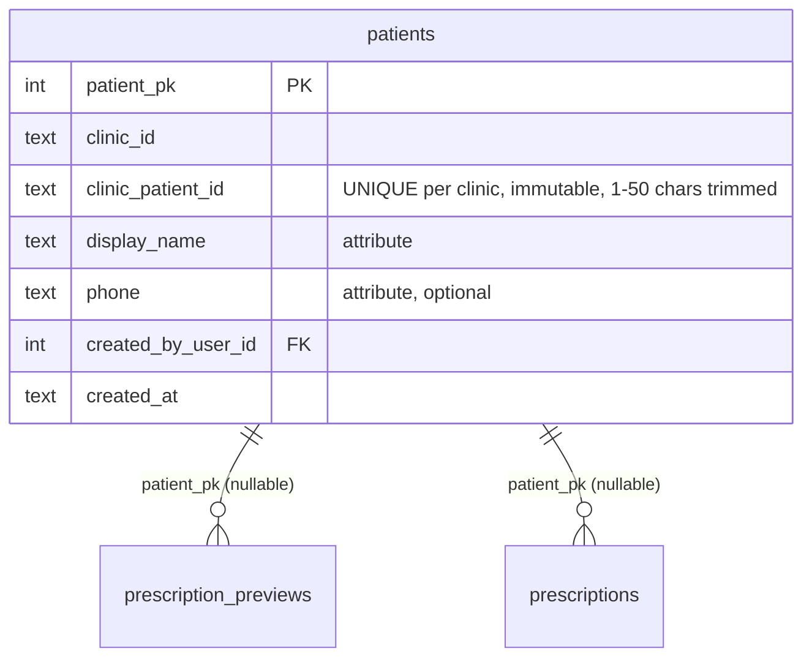
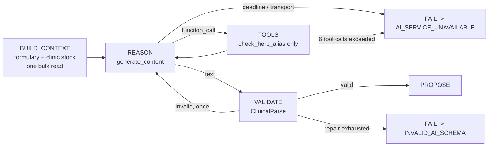

# AyurCore OS — Feature Dossier (backend, data, AI, evaluation)

**Prepared:** 2026-09-27, from direct inspection of this repository. **Revised the same day** after Encounter Phases 1A/1B (migrations 010–012), encounter auditing, the backup-report fix and contract addendum v1.6; and again after the post-1B security-review fixes (migrations 013–014, `scripts/audit_anchor.py`, 423 tests); and again after structured prescription items (migration 015) and Phase 2B, structured data as the authoritative source (migration 016, 446 tests).
**Scope:** everything implemented **except** the Next.js and Streamlit implementations. Frontends are mentioned only where an end-to-end integration gap exists.
**Source of truth:** the current code. Existing documents are cited where they agree and flagged in [§14](#14-documentation--code-discrepancies) where they don't.
**Method:** read-only inspection of source, migrations, tests, scripts, artifacts and documents, plus read-only queries against the development database `db/ayurcore.db` (§9.4). No code, configuration, test or database change was made to produce this document.

---

## Status vocabulary

| Label | Meaning in this document |
|---|---|
| **VERIFIED** | Implemented, and covered by automated tests that passed in the latest recorded run (§11.3). |
| **IMPLEMENTED** | Present in code, but without a dedicated automated test, or verified only indirectly. |
| **PARTIAL** | Some of the capability exists; a named part is missing. |
| **DEFERRED** | Deliberately postponed; the design or a placeholder exists. |
| **BLOCKED** | Cannot proceed for a reason outside the code (funds, quota, clinician input). |
| **NOT IMPLEMENTED** | Nothing in the repository implements it. |

"Synthetic technical evaluation" and "clinical validation" are kept strictly separate. **No clinical validation of any kind has been performed** (§10).

---

## Contents
1. [Architecture and trust boundary](#1-architecture-and-trust-boundary)
2. [Authentication, sessions, RBAC, clinic isolation](#2-authentication-sessions-rbac-clinic-isolation)
3. [Preview, confirmation, atomic inventory](#3-preview-lifecycle-deterministic-confirmation-atomic-inventory)
4. [Herb resolution and Gemini integration](#4-canonical-herb-resolution-and-gemini-integration)
5. [PII protection, security controls, failure handling](#5-pii-protection-security-controls-failure-handling)
6. [Idempotency and tamper-evident audit](#6-idempotency-and-tamper-evident-audit)
7. [Patient registry](#7-patient-registry-identity-linkage-search-history)
8. [A0 bounded agent](#8-a0-bounded-agentic-parser)
9. [Database, migrations, backup, operations](#9-database-migrations-backuprestore-operational-health)
10. [Clinical evaluation infrastructure and results](#10-clinical-evaluation-infrastructure-results-and-limits)
11. [Demo data and test coverage](#11-demo-data-infrastructure-and-test-coverage)
12. [Complete API inventory](#12-complete-api-inventory)
13. [Readiness matrix](#13-readiness-matrix)
14. [Documentation / code discrepancies](#14-documentation--code-discrepancies)
15. [Bugs fixed, limitations, deferred, not implemented](#15-known-bugs-fixed-limitations-deferred-and-unimplemented)
16. [Outstanding product/backend gaps (unranked)](#16-outstanding-productbackend-gaps-unranked)

---

## 1. Architecture and trust boundary

### 1.1 Components

| Layer | Implementation | Evidence |
|---|---|---|
| API | FastAPI app, 15 routes, all synchronous `def` handlers | `backend/main.py` |
| Domain modules | auth, RBAC, previews, inventory, herbs, PII, idempotency, audit, corrections, patients, encounters | `backend/*.py` |
| AI parsing (Control, the live path) | Gemini via `google-genai` with SDK automatic function calling | `agents/copilot.py` |
| AI parsing (A0, evaluation only) | Bounded, hand-driven tool loop | `agents/a0/` |
| Storage | One SQLite file in WAL mode | `db/database.py`, `db/ayurcore.db` |
| Schema management | Versioned migration runner (001–016), with an audit-chain integrity guard | `db/migrations.py`, `migrations/` |
| Tooling | Backup/restore, demo seeding, evaluation harnesses, verification scripts | `scripts/` |

Installed runtime, as recorded in `venv` (there is no dependency manifest, §9.5): Python 3.14.3, fastapi 0.141.1, starlette 1.6.0, pydantic 2.13.5, uvicorn 0.52.4, google-genai 2.23.0, argon2-cffi 25.1.0, python-multipart 0.0.32, python-dotenv 1.2.3.

### 1.2 Trust boundary: AI proposes, human confirms, deterministic backend commits

What the code guarantees:
- **`/prescribe/confirm` never calls the AI.** No AI import or call appears in the handler (`backend/main.py:662` onward).
- **It is the only path that deducts stock or writes a prescription.** It calls `deduct_and_prescribe` (`backend/inventory_service.py:37`) inside the caller's transaction.
- **`/prescribe/preview` writes only a PENDING preview row.** It uses `create_preview` (`backend/preview_store.py`).
- **The AI output is always normalized and re-checked.** It passes through `normalize_herb` at preview time and again at confirm (`backend/main.py`, herb normalization blocks).

Status: **VERIFIED**
- `tests/test_preview_lifecycle.py` (10 tests)
- `tests/test_golden.py` (3)
- `tests/test_manual_fallback.py` (5)
- `tests/test_confirm_input_bounds.py` (9)

---

## 2. Authentication, sessions, RBAC, clinic isolation

### 2.1 Authentication and sessions — VERIFIED

| Aspect | Implementation | Evidence |
|---|---|---|
| Password hashing | Argon2id (argon2-cffi `PasswordHasher`), lazily imported | `backend/auth_service.py:114-186` |
| Enumeration resistance | Exactly one Argon2 verify on every path; a dummy hash is used for unknown usernames; the same `None` result for unknown user, wrong password, inactive account or throttled account | `backend/auth_service.py:309+` |
| Session tokens | `secrets.token_urlsafe(32)`; only the SHA-256 hash is stored | `backend/auth_service.py:412-440`, `migrations/005_sessions.sql` |
| Session TTL | 12 hours (`SESSION_TTL_SECONDS`) | `backend/auth_service.py:61` |
| Resolution | Live join to `users` on every request, so role, clinic and deactivation changes apply on the next request; `last_seen_at` is updated | `backend/auth_service.py:441-509` |
| Revocation | `POST /auth/logout` sets `revoked_at` | `backend/auth_service.py:511`, `backend/main.py:252` |
| Login throttle | 5 consecutive failures lead to a 45-second cooldown, per existing user | `backend/auth_service.py:74-75`, `migrations/008_login_throttle.sql` |

Tests:
- `tests/test_auth_service.py` (40)
- `tests/test_auth_endpoints.py` (14)
- `tests/test_auth_edge_cases.py` (6)

**Limitations:**
- **No user management.** No registration or user-management API exists; users are created only through `create_user()` from scripts and tests.
- **Throttle scope:** the throttle is per existing account. Unknown usernames aren't throttled, and there's no IP-level rate limiting.
- **No session cleanup:** expired or revoked sessions are never deleted (no `DELETE` statement exists anywhere in `backend/`).

### 2.2 RBAC — VERIFIED

The single source of truth is `backend/rbac.py`: `PERMISSION_MATRIX` plus `require_auth` and `require_role`. A 401 always takes precedence over a 403.

| Capability | DOCTOR | ADMIN | AUDITOR |
|---|:-:|:-:|:-:|
| Prescribe (preview, manual-preview, confirm) | ✅ | ❌ | ❌ |
| Audit export and events | ❌ | ✅ | ✅ |
| Patients (register, search, history) | ✅ | ✅ | ❌ |
| Encounters: open, close | ✅ | ❌ | ❌ |
| Encounters: read, list | ✅ | ✅ | ❌ |
| Logout | ✅ | ✅ | ✅ |

Roles are constrained at the database level: `users.role CHECK IN ('DOCTOR','ADMIN','AUDITOR')` (`migrations/004_users.sql`).

Tests:
- `tests/test_rbac.py` (18)
- `tests/test_patients.py`
- `tests/test_patient_search_history.py`

### 2.3 Clinic isolation — VERIFIED

- **Clinic always comes from the session.** `clinic_id` is always `auth.clinic_id`, taken from the session join. A client-supplied `clinic_id` is:
  - **ignored** on the preview requests (`backend/schemas.py`, `PreviewRequest.clinic_id` legacy field);
  - **rejected with 403** on the audit endpoints (`backend/main.py:1070-1195`);
  - **rejected with 422** on `POST /patients` (`extra="forbid"`).
- **Cross-clinic previews are hidden.** A preview from another clinic gives the same 404 as a nonexistent one, and ownership is checked *before* status (`backend/preview_store.py`, `get_pending_preview_for_confirm` docstring).
- **Patient isolation is enforced twice:**
  - in SQL (`WHERE clinic_id = ?`);
  - at write time by triggers (§7, `migrations/009_patients.py`).
- **Stock reads by the AI are clinic-scoped.** Control's `check_stock` tool reads the request's clinic via a ContextVar (`agents/copilot.py:103-257`); A0 uses `list_stock(ctx.clinic_id)`.

Tests:
- `tests/test_rbac.py`
- `tests/test_a0_step0_hardening.py` (12)
- `tests/test_patients.py`
- `tests/test_patient_search_history.py`

**Limitations:**
- **No clinic entity.** `clinic_id` is a free-text string on each row; there's no `clinics` table and no validation that a clinic exists.
- **One file for all clinics.** Isolation is enforced by application logic and triggers in a single shared SQLite file, not by separate databases.

---

## 3. Preview lifecycle, deterministic confirmation, atomic inventory

### 3.1 Preview state machine — VERIFIED

- **Persistence:** stored in `prescription_previews` (`migrations/003_prescription_previews.sql`, plus the `patient_pk` column from 009). Previews survive restarts; the earlier in-memory dict was replaced (§15.1).
- **IDs:** `preview_id = secrets.token_hex(8)`.
- **Two value pairs:** the AI proposal and the confirmed values are kept in separate column pairs.
- **Expiry is lazy:** `mark_stale_previews_expired()` runs whenever a preview is created, so there's no background job (`backend/preview_store.py:309+`).
- **Session binding:** `created_by_session` must equal the confirming session, otherwise 403 (`backend/main.py`, confirm handler).

Tests:
- `tests/test_preview_store.py` (9)
- `tests/test_preview_lifecycle.py` (10)

**Limitations:**
- **Re-login loses drafts.** A doctor who logs out and back in cannot confirm their own pending preview (by design).
- **Nothing is purged.** Expired and confirmed previews are never deleted, and they contain patient name, phone and ID (retention, §15.3).

### 3.2 Manual fallback — VERIFIED

`POST /prescribe/manual-preview` (`backend/main.py:572`):
- takes the doctor's own dosha and herbs, with no AI call;
- applies the same `normalize_herb` rejection;
- stores `is_manual=1`.

At confirm, a manual preview is **excluded from `corrections`**, so no fabricated "AI proposal", and its audit event is labelled `MANUAL` with `ai_proposal: null`.

Tests: `tests/test_manual_fallback.py` (5).

### 3.3 Deterministic confirmation — VERIFIED

`POST /prescribe/confirm` (`backend/main.py:662-1060`) runs all of the following in one `BEGIN IMMEDIATE` transaction:
1. optional idempotency reservation (§6.1);
2. preview load with the clinic check first, then status;
3. session-binding check;
4. applying the doctor's corrections or the stored proposal;
5. `normalize_herb` on every herb;
6. `deduct_and_prescribe` (stock deduction, prescription insert and its `prescription_items`), after a check that no herb's merged total exceeds 10,000 g (422);
7. `create_audit_event`;
8. `mark_confirmed`;
9. idempotency completion.

Any exception rolls back everything. Corrections logging runs **after** commit, as a best-effort step that can never roll back a prescription.

### 3.4 Atomic inventory deduction — VERIFIED

`deduct_and_prescribe` (`backend/inventory_service.py:37-137`):
- merges duplicate herbs;
- runs a per-herb conditional `UPDATE inventory SET stock_grams = stock_grams - ? WHERE herb_name=? AND clinic_id=? AND stock_grams >= ?`;
- raises `InsufficientStockError` (409) and rolls back if any herb can't be covered;
- inserts the `prescriptions` row, with `patient_pk` since migration 009;
- **since migration 015,** inserts one `prescription_items` row per canonical herb (`line_no` in first-appearance order, merged total grams), on the same connection and transaction.

A database `CHECK (stock_grams >= 0)` backs this up.

Tests: `tests/test_golden.py` (rollback on insufficient stock; concurrent confirms never over-deduct).

**Limitations:**
- **No inventory API.** No endpoint reads, restocks or adjusts inventory. Inventory comes only from `db/seed.py`, `scripts/seed_demo_data.py` or tests (§9.5).
- **Structured data is authoritative (migrations 015–016).** Herbs are in `prescription_items` (since 015) and dosha in `prescriptions.dosha_imbalance` (since 016). Patient history, the only backend reader of prescription content, uses them first, field by field, and parses `description` only for a field with no structured value. `description` is still written, unchanged, for compatibility. Nothing was backfilled: prescriptions confirmed before 015 have neither, and those confirmed between 015 and 016 have items but no dosha column.
- **Immutable (016).** A prescription's content (`patient_name`, `description`, `created_at`, `dosha_imbalance`, and an unlinked row's `clinic_id`) can't be updated, no prescription can be deleted, items can be added only to the prescription currently being written, and an item can't exceed 10,000 g. `status` stays writable for a future lifecycle; nothing writes it.
- **`status` is always `"Active"`.** No lifecycle (void, amend, dispense) exists.

---

## 4. Canonical herb resolution and Gemini integration

### 4.1 Herb resolution — VERIFIED

- **Formulary:** `backend/herb_resolver.py` holds `HERB_ALIASES`, mapping English, botanical and Malayalam-script aliases to **20 canonical herbs**.
- **Matching:** `normalize_herb` is an exact, case-insensitive dictionary lookup that raises `UnknownHerbError`. The preview returns 400, and **one unknown herb rejects the whole preview**.
- **The formulary is hand-maintained in several places:**
  - `agents/copilot.py` `SEED_HERBS`
  - `backend/herb_resolver.py`
  - `db/seed.py` (20 rows)
  - `backend/namaste_codes.py` (20 keys, all `None`)
  - the Streamlit keyterms list
- A0 derives its formulary from `HERB_ALIASES` (`agents/a0/context.py`).
- **Not all 20 herbs have Malayalam aliases.** For example, `triphala`, `shankhpushpi` and `kutki` have none.

### 4.2 Gemini integration (Control, the only live path) — VERIFIED (offline), live behaviour limited (§10)

| Setting | Value | Evidence |
|---|---|---|
| Model | `GEMINI_MODEL` environment variable, default `gemini-3.6-flash` | `agents/copilot.py:48` |
| Temperature | 0.1 (hardcoded) | `agents/copilot.py` |
| Tools | `check_herb_alias`, `check_stock` (read-only); SDK automatic function calling | `agents/copilot.py:206-257` |
| Per-request timeout | 45 s (`HttpOptions`) | `agents/copilot.py:68` |
| Total budget | 40 s monotonic, enforced by a worker thread with a bounded wait; `check_stock` stops touching the database after the deadline | `agents/copilot.py:82-166` |
| Output | JSON validated as `ClinicalParse` (`dosha_imbalance: str`, `prescribed_herbs: [{name, grams 1..10000}]`) | `backend/schemas.py` |
| Failure mapping | any SDK or transport failure → `AI_SERVICE_UNAVAILABLE` (502 plus `X-Error-Code`); bad JSON → `INVALID_AI_SCHEMA` (422) | `agents/copilot.py:400-429`, `backend/main.py` |

Tests:
- `tests/test_copilot_tool_calling.py` (3)
- `tests/test_gemini_timeout.py` (5)
- `tests/test_a0_step0_hardening.py`

All use fake clients; there's no live call in the test suite.

**Limitations:**
- **Missing key switches to a mock.** With no `GEMINI_API_KEY`, `parse_clinical_notes` uses a hardcoded **mock parser** (`agents/copilot.py:283-293`). It returns fixed answers for three test strings and `AI_SERVICE_UNAVAILABLE` otherwise, so a deployment without a key silently runs in that mode.
- **Herb names go to stdout.** `AYURCORE_LOG_TOOL_CALLS` defaults on and `print`s the herb names from tool calls (`agents/copilot.py:33`). That isn't PII, but it goes to stdout rather than the logger.
- **Structured-output limits:** only dosha and total grams. No frequency, duration, dosage form or instructions are captured, and none are graded (§10).
- **No per-user or per-clinic rate limit on `/prescribe/preview`,** which is the endpoint that incurs Gemini cost.

---

## 5. PII protection, security controls, failure handling

### 5.1 PII protection before Gemini — VERIFIED

`backend/pii_sanitizer.py`:
- `tokenize_payload` replaces known identity values with `[[PAT_<hex>]]` tokens from a CSPRNG, longest value first;
- `expand_name_variants` adds individual name words, skipping titles;
- `assert_no_pii_leak` is a hard pre-flight stop;
- `rehydrate_payload` and `find_unresolved_tokens` restore values on the way back and abort with 502 on an unknown token.

The mapping is request-scoped and never persisted. When a preview is linked to a registered patient, the registry's name, phone and OP number are tokenized as well (`backend/main.py`, preview handler).

Tests:
- `tests/test_pii_sanitizer.py` (13)
- `tests/test_pii_airgap.py` (3)
- `tests/test_patients.py` (registry identifiers are tokenized)

**Limitations:**
- **Identity kept out of free-text clinical fields (2026-09-27).**
  - An AI reply containing any `[[PAT_…]]` placeholder is rejected (422) rather than turned back into the real identity.
  - A dosha containing the patient's own name (or any part of 3+ letters), phone or ID is rejected on AI preview, manual preview and confirm, with nothing written (`backend/pii_sanitizer.contains_identity`, whole-word matching).

  Before this fix, a patient name could reach AUDITOR through `ai_proposal.dosha` and `doctor_decision.dosha` (security review finding 3.1, demonstrated on a scratch copy).
- **Only known identifiers are tokenized.** Values not supplied as identity fields (addresses, relatives' names, free-form IDs in the notes) are not detected, and there's no NER or pattern detection.
- **No encryption at rest.** Patient identity is stored in plaintext in `prescriptions`, `prescription_previews`, `patients` and `idempotency_keys.response_body_json` (`migrations/006_idempotency_keys.sql` comments). The live database isn't encrypted; only backup artifacts can be (§9.3).

### 5.2 Other security controls

| Control | Status | Evidence |
|---|---|---|
| CORS restricted to `http://localhost:3000` and `http://127.0.0.1:3000`, credentials off | IMPLEMENTED (hardcoded dev origins) | `backend/main.py` `CORSMiddleware` |
| Input bounds on all request fields (lengths, grams 1–10000, list sizes) | VERIFIED | `backend/schemas.py`, `tests/test_confirm_input_bounds.py` |
| Unsupported HTTP methods return 405 before auth | VERIFIED | `tests/test_unsupported_methods.py` (6) |
| PII-free structured logging (`ayurcore` logger at INFO) | VERIFIED | `backend/main.py` logger setup, `scripts/a61_logging_diagnosis.py` |
| `/docs` and `/openapi.json` | enabled (FastAPI default, not disabled) | `backend/main.py:99` `FastAPI(title=...)` |
| HTTPS, reverse proxy, firewall | NOT IMPLEMENTED (plan only) | `documentation/docs/AyurCore_Production_Readiness_Plan.md` |

### 5.3 Failure handling — VERIFIED

| Situation | Behaviour |
|---|---|
| AI outage (quota, timeout, network) | 502 with `X-Error-Code: AI_SERVICE_UNAVAILABLE`; the manual fallback remains available |
| Malformed AI output | 422 "Invalid AI schema returned" |
| Unknown herb (AI or doctor) | 400, nothing written |
| Insufficient stock | 409, transaction rolled back |
| Schema not migrated | `SchemaNotMigratedError`, a loud 500 |
| Audit write failure | the whole confirm transaction is rolled back |
| Corrections-log failure | logged; the prescription is kept |
| Patient link rejected by a database trigger | 404; never retried as an ID collision (`backend/preview_store.py` `PatientLinkError`) |
| Database lock not obtained within the busy timeout | 503 with `X-Error-Code: DATABASE_BUSY` and `Retry-After`, nothing written (`backend/main.py` `sqlite3.OperationalError` handler). Housekeeping writes (`last_seen_at`, the preview-expiry sweep) fail fast instead of waiting, and a locked preview insert is no longer retried five times. Worst case under contention is about one busy timeout, not about 31 s. |

---

## 6. Idempotency and tamper-evident audit

### 6.1 Idempotent confirmation — VERIFIED

- **Scope:** the optional `Idempotency-Key` header on `/prescribe/confirm` (`documentation/docs/archive/api-contract/AyurCore_API_Contract_v1.4_addendum.md`).
- **Reservation:** keyed on `(user_id, "prescribe_confirm", key)` inside the confirm transaction (`backend/idempotency_store.py`, `migrations/006_idempotency_keys.sql`).
- **Fingerprint:** the request fingerprint is SHA-256 of `{preview_id, dosha_imbalance, prescribed_herbs}` as sent.
- **Outcomes:**
  - same key and same payload replays the stored response;
  - a changed payload gives 409;
  - a clinic mismatch gives 409;
  - concurrent duplicates commit exactly once.

Tests:
- `tests/test_idempotency.py` (8)
- `tests/test_idempotency_store.py` (8)
- `tests/test_idempotency_hardening.py` (6)

**Limitations:**
- **Confirm only.** Idempotency covers only `/prescribe/confirm`; `POST /patients` has none (a retry after a timeout returns 409 duplicate).
- **No expiry.** Keys, and their stored responses containing patient names, never expire.

### 6.2 Tamper-evident audit chain — VERIFIED

- **Storage:** `audit_events` (`migrations/007_audit_events.sql`, rebuilt by `migrations/011_audit_encounter_events.py`). Three event types:
  - `PRESCRIPTION_CONFIRMED`, written inside the confirm transaction;
  - `ENCOUNTER_OPENED` and `ENCOUNTER_CLOSED`, written inside the same transaction as the encounter change (`backend/encounter_store.py`).

  Encounter events have NULL `prescription_id`/`preview_id` (enforced by a CHECK) and `event_data = {"encounter_pk": N}`.
- **Content:** for confirms, `event_data` holds `decision_source` (`AI_ASSISTED`/`MANUAL`), the AI proposal (or null), the confirmed values and `was_changed`, plus the opaque `encounter_pk` only when confirmed inside an encounter. There is **no patient identity** and no `patient_pk` (`backend/audit_store.py`).
- **Rebuild safety (migration 011):** the migration copies every row verbatim and aborts unless IDs and hashes are identical. It was also proven on a copy of the real database (2,531 events identical, chain valid) before the live upgrade (`tests/test_encounter_linkage.py`).
- **Chaining:** `event_hash = SHA-256(canonical_envelope + previous_event_hash)`, one chain per clinic.
- **Verification:** `verify_audit_integrity` recomputes the chain, and `GET /audit/events` runs it live on every call (`backend/main.py:1145`).
- **Current state:** a read-only run on 2026-09-27, after migrations 011–012, reported **valid, 0 violations** across all clinics: 2,752 events (2,636 `PRESCRIPTION_CONFIRMED`, 80 `ENCOUNTER_OPENED`, 36 `ENCOUNTER_CLOSED`, all from test runs).

Tests:
- `tests/test_audit_store.py` (11)
- `tests/test_audit.py` (10)
- `tests/test_audit_export.py` (4)
- `tests/test_encounters.py`, `tests/test_encounter_linkage.py` (encounter events, rebuild, interleaved chain)

**Limitations (from code inspection):**
- **Append-only (migration 014):** triggers reject every `UPDATE` and `DELETE` on `audit_events`. Anyone with write access to the database *file* can drop them first.
- **External anchor (`scripts/audit_anchor.py`):** HMAC-signed, off-database checkpoints per clinic (count, last event id, last hash). `verify` detects:
  - tail truncation or deletion back past a checkpoint;
  - a rewritten or recomputed chain at an anchored event;
  - changed counts;
  - a forged checkpoint line.

  Covered by `tests/test_security_hardening.py`. **Remaining window:** events written after the latest checkpoint are protected only by the triggers and the chain, and nothing schedules checkpoints automatically (runbook §8).
- **Migration guard:** `db/migrations.run_migrations(integrity_guard=audit_chain_validity)`, used at startup, recomputes every chain before and after a migration batch in the same transaction. It rolls back the whole batch if any valid chain breaks, including content-only edits.
- **Only confirmations and encounter open/close are audited.** Logins, previews, failed confirms, patient registrations and audit reads are not audited events.
- **Unpaginated exports.** `/audit/export` and `/audit/events` return a clinic's entire history.
- **Legacy gap:** the development database holds 2,978 prescriptions but 2,447 audit events. That is consistent with prescriptions written before migration 007 existed, but not verified row by row.

### 6.3 Corrections dataset — VERIFIED (with a caveat)

- **What it records:** `corrections` (`migrations/001_baseline_schema.sql`, `backend/corrections_service.py`) stores the AI proposal versus the confirmed values for AI previews only.
- **Where it's exposed:** through `GET /audit/export` (ADMIN/AUDITOR, own clinic).
- **Caveat:** `was_changed` is a direct Python list/string comparison (`backend/corrections_service.py:31-34`). It is order- and case-sensitive, so reordering herbs without changing them would count as a change. From code inspection; no test exercises reordering.
- **Not linked to parser version or patient:** there is no Control/A0 marker and no `patient_pk`.

---

## 7. Patient registry, identity, linkage, search, history

Delivered in three steps: Phase 1 (migration 009, registration, linking at preview and confirm), Phase 2A (search and history APIs), and a Next.js Patients screen (out of scope here).

### 7.1 Identity model — VERIFIED

- **Identity** is the pair (`clinic_id`, `clinic_patient_id`).
- **Name and phone** are attributes, not identity.
- **Existing prescriptions** are **not** backfilled or matched; they stay `patient_pk NULL`.

### 7.2 Write-time enforcement (`migrations/009_patients.py`, 8 triggers) — VERIFIED

A `.py` migration was needed because the `.sql` splitter cuts on `;` (`db/migrations.py` docstring).

| Trigger | Effect |
|---|---|
| `previews_patient_clinic_insert` / `_update` | A preview can only link a patient of the preview's own clinic |
| `prescriptions_patient_clinic_insert` / `_update` | Same rule for prescriptions, including moving a prescription to another clinic |
| `previews_patient_link_immutable`, `prescriptions_patient_link_immutable` | A link can't change once written, so old rows can't be linked later |
| `patients_identity_immutable` | `patient_pk`, `clinic_id` and `clinic_patient_id` can't be changed |
| `patients_no_delete` | Patients can't be deleted |

The triggers work whether or not the connection enables foreign keys. Verified on a fresh database and on an upgrade from 008 (`tests/test_patients.py`, migration and trigger tests).

### 7.3 APIs

| Endpoint | Behaviour | Status |
|---|---|---|
| `POST /patients` | Registers in the session's clinic. Extra fields, including `clinic_id`, give 422; a duplicate in the same clinic gives 409; the same ID in another clinic is allowed. Returns 201 with `{patient_pk, clinic_patient_id, display_name, phone, created_at}`. | VERIFIED |
| `patient_pk` on preview and manual-preview | Optional. The patient is looked up within the session's clinic; a foreign or missing patient gets the same 404 **before any AI call or write**. When linked, the registry values become the stored identity and are also tokenized. | VERIFIED |
| Confirm linkage | `patient_pk` is copied from the **stored preview**; `ConfirmRequest` has no patient field. | VERIFIED |
| `GET /patients?q=` | Query 2–100 characters after trimming. Case-insensitive substring match on ID or name, with LIKE wildcards escaped. Ranking: exact ID, then ID prefix, then the rest. At most 20 results plus `truncated`. Returns only `{patient_pk, clinic_patient_id, display_name}`. | VERIFIED |
| `GET /patients/{patient_pk}/prescriptions` | The patient must be in the caller's clinic, otherwise the same 404. Linked prescriptions only, newest first (`created_at DESC, id DESC`). `limit` 1–50 (default 20), `offset` ≥ 0, `has_more`. Dosha and herbs are parsed from `description`; an unrecognized format returns nulls. | VERIFIED |

Code: `backend/patient_store.py`, `backend/main.py:262-370`, `backend/schemas.py`.

Tests:
- `tests/test_patients.py` (12)
- `tests/test_patient_search_history.py` (11), covering:
  - RBAC and clinic isolation;
  - no AI calls and no writes;
  - pagination;
  - literal wildcards;
  - exclusion of unlinked prescriptions with the same name.

Contract: `documentation/docs/archive/api-contract/AyurCore_API_Contract_v1.5_addendum.md` covers Phase 1 only (§14).

**Gaps:**
- **No client links patients yet (end-to-end).** Neither prescribing client sends `patient_pk`:
  - the Next.js consultation flow calls preview and manual-preview with free-text `patient_name`/`patient_id` only;
  - `ui/app.py` has no patient-registry references.

  **No prescription created through a UI today is linked to a patient.** All 24 linked prescriptions in the development database come from tests.
- **`patient_pk` is optional,** so history coverage depends on clients adopting it.
- **Not implemented:** editing patient attributes, merging duplicates, linking legacy prescriptions (blocked by the immutability triggers until a new, audited design exists), and audit events for registry changes.
- **History is only as good as the text record:** it depends on parsing `prescriptions.description` (§3.4).

---

### 7.4 Encounters and encounter linkage (Phases 1A/1B) — VERIFIED (API); not used by any client

- **Model:** `encounters` (`migrations/010_encounters.py`, `backend/encounter_store.py`) holds one consultation episode per row: `encounter_pk, clinic_id, patient_pk, created_by_user_id, status, created_at, closed_at`.
- **Lifecycle:** `OPEN` → `CLOSED`, and `CLOSED` is final. At most one `OPEN` encounter per patient (partial unique index).
- **Encounter rules enforced at write time** (4 triggers plus CHECKs):
  - the patient and the creator must belong to the encounter's clinic;
  - identity fields can't change;
  - a closed encounter can't be updated;
  - encounters can't be deleted.
- **Endpoints:**
  - `POST /patients/{pk}/encounters` (DOCTOR)
  - `GET /patients/{pk}/encounters` (DOCTOR, ADMIN)
  - `GET /encounters/{pk}` (DOCTOR, ADMIN)
  - `POST /encounters/{pk}/close` (DOCTOR)

  The create body must be empty; any field, including `clinic_id`, gives 422. A foreign or missing patient or encounter gets the same 404. Open and close each write an audit event in the same `BEGIN IMMEDIATE` transaction.
- **Linkage (migration 012):**
  - `prescription_previews.encounter_pk` and `prescriptions.encounter_pk` are nullable.
  - Preview and manual-preview accept an optional `encounter_pk`, checked before any AI call: it requires `patient_pk` (422), must be in the caller's clinic (404), must belong to the same patient (409), and must be `OPEN` (409).
  - Confirm copies the encounter from the stored preview only, and re-checks that it is still `OPEN` inside its transaction. A draft whose encounter was closed is refused with 409 and **nothing written**.
  - Triggers enforce the same clinic, patient and `OPEN` rule on both tables, and make the link immutable.
  - Idempotent replay after the encounter closes still returns the original response.
- **Tests:**
  - `tests/test_encounters.py` (10)
  - `tests/test_encounter_linkage.py` (10), covering:
    - cross-clinic and cross-patient attempts;
    - missing and closed encounters, and an encounter without a patient;
    - replay;
    - restart;
    - concurrent confirms, and a close racing a confirm;
    - backward compatibility;
    - audit PII;
    - migration 011 chain preservation.
- **Contract:** `documentation/docs/archive/api-contract/AyurCore_API_Contract_v1.6_addendum.md`, sections F4 and F5.

**Gaps:**
- **No client uses encounters.** No frontend sends `encounter_pk` or opens encounters.
- **Optional linkage:** `encounter_pk` is optional.
- **No clinical content:** encounters carry no notes, diagnosis or vitals.
- **Auditor visibility:** since migration 013, encounter audit events carry a random 16-hex `encounter_ref`, not the global sequential `encounter_pk`, so they reveal nothing about other clinics' encounter volume. Confirm events carry **no** encounter reference, so auditors can't group prescriptions by visit. AUDITOR still sees that encounter `<ref>` was opened or closed by user `X` at time `T`, with no patient linkage. Events written before 013 keep `encounter_pk` (they are hashed and immutable).

---

## 8. A0 bounded agentic parser

### 8.1 Architecture — IMPLEMENTED (evaluation arm only)

`agents/a0/orchestrator.py`, `context.py`, `prompt.py`, `tools.py`:
- **Hand-driven loop:** automatic function calling is disabled, so the orchestrator runs the loop itself.
- **Surface:** the public API is exactly `propose` and `AgentContext`. The context is frozen and carries only `clinic_id` and `request_id`.

### 8.2 Safety limits

| Bound | Value | Enforced by |
|---|---|---|
| Tool calls per preview | 6 | counter in `_reason_until_text` |
| Reasoning calls | 2 (one initial, one repair) | loop in `propose` |
| Total deadline | 40 s monotonic, checked before every model call | `_deadline_exceeded` |
| Per-request timeout | 45 s | `HttpOptions` |
| Tool surface | `check_herb_alias` only; stock is embedded in the prompt | `agents/a0/tools.py` |
| Write reachability | no transitive import of any write function | `tests/test_a0_no_write_imports.py` |

### 8.3 Verification

**VERIFIED offline:**
- `tests/test_a0_bounds.py` (7)
- `tests/test_a0_no_write_imports.py` (5)
- `tests/test_a0_parity.py` (4)
- `tests/test_a0_step0_hardening.py` (12, shared with Control)

### 8.4 Integration status — **NOT WIRED INTO PRODUCTION**

- **Production calls Control unconditionally.** `backend/main.py` imports and calls only `agents.copilot.parse_clinical_notes` (preview handler).
- **The documented flag doesn't exist.** No `AYURCORE_A0_ENABLED` flag, or any other switch, exists in the backend, even though `agents/a0/orchestrator.py`'s docstring describes one (§14).
- **The only entry points are harnesses:** `scripts/a0_baseline_harness.py --arm a0` and `scripts/clinical_eval_harness.py --arm a0`.
- **Current fingerprint** (`agents/a0/*`): `1ef0196`.

### 8.5 Evaluation status — BLOCKED (live)

A0 has **no live evaluation result**. The one live A0 run (2026-09-26) was stopped before any case completed, because the free Gemini quota was exhausted (429) and no paid quota was available (§10.3).

---

## 9. Database, migrations, backup/restore, operational health

### 9.1 Schema (applied migrations 1–16 on the development database)

| Table | Purpose | Migration | Clinic-scoped |
|---|---|---|:-:|
| `inventory` | Stock per clinic and herb (`CHECK stock_grams >= 0`) | 001 | ✅ |
| `prescriptions` | Confirmed prescriptions (`description` holds dosha and formulation as text, kept for compatibility; `patient_pk` from 009; `encounter_pk` from 012; structured `dosha_imbalance` from 016; content immutable from 016) | 001, 009, 012, 016 | ✅ |
| `panchakarma_resources` | **Unused by any backend code** | 001, 002 | ✅ (002) |
| `corrections` | AI proposal vs confirmed | 001 | ✅ |
| `prescription_previews` | Persistent previews (`patient_pk` 009, `encounter_pk` 012) | 003, 009, 012 | ✅ |
| `users` | Accounts, Argon2id hash, role, clinic | 004 | ✅ |
| `sessions` | Hashed opaque tokens | 005 | via user |
| `idempotency_keys` | Confirm dedup plus stored response | 006 | ✅ |
| `audit_events` | Hash-chained confirm and encounter events | 007, 011 (rebuild) | ✅ |
| `login_throttle` | Failure counter and lock | 008 | via user |
| `patients` | Registry | 009 | ✅ |
| `encounters` | Consultation episodes (OPEN/CLOSED) | 010 | ✅ |
| `prescription_items` | One immutable line per canonical herb of a confirmed prescription (`line_no`, `herb_name`, total `grams`) | 015 | ✅ |
| `schema_migrations` | Applied versions and checksums | runner | — |

The development database also has **27 triggers** (8 from 009; 4 from 010, with 013 recreating two of them and adding `encounters_ref_required`; 4 from 012; 2 from 014 making `audit_events` append-only; 4 from 015: item insert rules, sealing once the confirmation is audited, no update, no delete; 4 from 016: prescription content immutable, no prescription delete, item gram limit, items only on the newest prescription) and runs in `journal_mode=wal`.

### 9.2 Migration runner — VERIFIED

`db/migrations.py`:
- ordered `NNN_*.sql|.py` files, with duplicate version numbers rejected;
- SHA-256 checksums, so an edited historical migration is detected;
- `BEGIN IMMEDIATE` plus one SAVEPOINT per migration;
- idempotent re-runs;
- runs at application startup (`backend/main.py` startup hook).

Tests:
- `tests/test_migrations.py` (11)
- `tests/test_patients.py` (009 fresh bootstrap and upgrade)

### 9.3 Backup and restore — VERIFIED (tool); scheduling NOT IMPLEMENTED

- **Backup:** `scripts/backup_db.py` takes a consistent `VACUUM INTO` snapshot, refuses to overwrite the live database, and verifies the result with `integrity_check` and `foreign_key_check`.
- **Encryption:** optional AES encryption of the backup through `openssl`, with the passphrase read from `AYURCORE_BACKUP_PASSPHRASE`; decryption is supported.
- **Procedure:** `documentation/docs/BACKUP_RESTORE_RUNBOOK.md`.
- **Tests:** `tests/test_backup.py` (15), which use temporary databases only.
- **Stricter verification (2026-09-27):** `verify_backup` now also requires every table the backup's recorded schema version implies (`TABLE_INTRODUCED_IN`) and verifies every audit chain inside the backup.
- **Report coverage:** `KNOWN_TABLES` (`scripts/backup_db.py`) now lists `patients`, `encounters` and (since 015) `prescription_items`, so both are included in the post-backup row counts (fixed 2026-09-27; previously D7).
- **Not implemented:**
  - scheduled or automated backups (the runbook documents a `launchd` example only);
  - off-machine replication (the Litestream plan is unimplemented);
  - encryption of the live database.

### 9.4 Operational health

- **Health endpoint:** `GET /health` returns a fixed `{"status": "ok"}` with no authentication and no database or AI access (`backend/main.py:198`, `tests/test_health.py`, 4 tests). It is a **liveness** check only; there is no readiness or database-connectivity check.
- **Development database contents (read-only counts, 2026-09-27):**

  | Table | Rows |
  |---|---|
  | users | 6,845 |
  | patients | 121 |
  | prescriptions | 2,978 (24 linked) |
  | prescription_previews | 4,253 |
  | audit_events | 2,447 |
  | corrections | 660 |
  | idempotency_keys | 902 |
  | sessions | 5,181 |

  Prescriptions span 551 distinct `clinic_id` values. **These are overwhelmingly test-run residue:** the pytest suite writes to the real `db/ayurcore.db`, and there's no `tests/conftest.py` isolating a test database. This database is not a clean demo or production dataset.
- **Not implemented:** metrics, error tracking (Sentry), uptime monitoring, log shipping.

### 9.5 Build and deployment

- **No dependency manifest:** there's no `requirements.txt` or `pyproject.toml`; versions exist only in `venv/`.
- **No packaging or CI:** no Dockerfile, Procfile or CI configuration.
- **Version control:** a Git repository was initialised on 2026-09-27 after the Phase 2 freeze (baseline commit `41a2d1f`). There is no remote or tag yet.
- **Destructive seeding:** `db/seed.py` runs `DELETE FROM inventory` with **no clinic filter** before seeding 20 `default_clinic` herbs, so it would wipe every clinic's stock. I didn't run it.
- **Hosting:** HTTPS, reverse proxy and production hosting are planned only (`documentation/docs/AyurCore_Production_Readiness_Plan.md`; every checklist item is unchecked).

---

## 10. Clinical evaluation infrastructure, results, and limits

### 10.1 Infrastructure — VERIFIED (offline)

| Component | Purpose | Evidence |
|---|---|---|
| `scripts/a0_baseline_harness.py` | Original Control/A0 baseline over 8 stress cases (unmodified, reused) | 669 lines |
| `scripts/clinical_eval_harness.py` | `--selfcheck`, `--live`, `--regrade`; raw and graded artifacts; deterministic grader | 975 lines |
| `eval/cases/clinical_eval_v1.json` | 12 AI-written cases, `evaluation_class: technical_synthetic_unreviewed`, SHA-256 `5ef6175f59a6…` | 4 from `scripts/verify_malayalam_manglish.py`, 8 from the stress script |
| `eval/cases/clinical_eval_v2_template.json` | Empty, non-runnable template for 30–50 clinician-reviewed cases | `template_status: TEMPLATE_NOT_FOR_EVALUATION` |
| `documentation/docs/CLINICAL_EVAL_GROUND_TRUTH.md`, `documentation/docs/CLINICAL_CASE_REVIEW_FORM.md` | Ground-truth protocol, freezing and versioning, per-case review form | — |

**Grading rules** (`scripts/clinical_eval_harness.py`):
- **Dosha:** compared as a set, never by substring.
- **Herbs:** per-herb precision and recall; gram delta against an explicit tolerance; herbs unresolvable by `normalize_herb` counted as hallucinated; flag when production would reject the whole preview.
- **Errors:** provider, parse and harness errors are separate and **never clinical misses**.
- **Ambiguous cases** are never PASS or FAIL.
- **Safety:** only clinician-supplied annotations are applied.
- **Doctor edits** are counted.
- **Recorded with each run:**
  - fingerprints of the case file, the parsers and the herb resolver;
  - both arms' model settings;
  - a stock snapshot hash;
  - latency, tool calls and error cause.
- **Disclaimer:** every report on a technical dataset carries "NOT CLINICAL VALIDATION".

Tests:
- `tests/test_clinical_eval_grader.py` (21)
- `tests/test_clinical_eval_v2_template.py` (12)

### 10.2 Synthetic technical evaluation — actual results

| Artifact | Arm | Mode | Result | Meaning |
|---|---|---|---|---|
| `artifacts/clinical_eval/20260926T134538Z_control_selfcheck_*` | Control | selfcheck | 8 PASS / 3 CLINICAL_MISS / 1 AMBIGUOUS | **Scripted responses**; exercises the grader only; no information about the model |
| `artifacts/clinical_eval/20260926T134540Z_a0_selfcheck_*` | A0 | selfcheck | same as Control | same |
| `artifacts/clinical_eval/20260926T140710Z_control_live_*` | Control | **live** | 1 PASS, **11 PROVIDER_ERROR** (one 503, then 429 quota exhausted) | 1 of 12 synthetic cases completed; **not a usable baseline** |
| `artifacts/a0_step0/baseline_20260920T070607Z_6004679_live.json` | Control | live | 5 PASS, 3 ERROR | older 8-case baseline; recorded against a **since-changed** `copilot.py` (`6004679`; current `08d6273`) |
| `artifacts/a0_step0/baseline_20260920T061154Z_b3bd02b_selfcheck.json` | Control | selfcheck | scripted | grader exercise only |

Fingerprints of the latest artifacts match the current code: `copilot.py` `08d6273`, A0 `1ef0196`, case file `5ef6175f59a6`.

### 10.3 Clinical validation — **NOT PERFORMED / BLOCKED**

- **No clinician-reviewed cases exist.** `eval/cases/clinical_eval_v2.json` hasn't been created. This is BLOCKED on clinician input.
- **No live A0 run completed,** and no complete live Control run exists. This is BLOCKED on Gemini quota or funds.
- **No Control-vs-A0 comparison report exists** (not implemented).
- **Nothing in this repository supports any claim about clinical accuracy or safety.**

---

## 11. Demo-data infrastructure and test coverage

### 11.1 Demo data — IMPLEMENTED

- **Script:** `scripts/seed_demo_data.py` (758 lines) creates 4 demo accounts (DOCTOR, ADMIN and AUDITOR in `default_clinic`; a DOCTOR in `test_clinic_b`), `test_clinic_b` inventory, and a 13-record prescription/audit history through the real endpoints.
- **Reset:** `--reset` is best-effort and uses a manifest.
- **Docs:** `documentation/docs/DEMO_DATA.md`. The demo password is documented there as a non-secret demo credential; it isn't reproduced here.
- **No patient-registry entries.** The script creates none, and its documentation predates the registry (§14).

### 11.2 Test inventory (backend and tooling; 446 test functions)

| Area | Files (test count) |
|---|---|
| Auth, sessions, throttle | `test_auth_service` (40), `test_auth_endpoints` (14), `test_auth_edge_cases` (6) |
| RBAC and isolation | `test_rbac` (18) |
| Preview, confirm, inventory | `test_preview_store` (9), `test_preview_lifecycle` (10), `test_manual_fallback` (5), `test_confirm_input_bounds` (9), `test_golden` (3), `test_unsupported_methods` (6) |
| AI integration | `test_copilot_tool_calling` (3), `test_gemini_timeout` (5) |
| PII | `test_pii_sanitizer` (13), `test_pii_airgap` (3) |
| Idempotency | `test_idempotency` (8), `test_idempotency_store` (8), `test_idempotency_hardening` (6) |
| Audit | `test_audit_store` (11), `test_audit` (10), `test_audit_export` (4) |
| Patients | `test_patients` (12), `test_patient_search_history` (11) |
| Encounters | `test_encounters` (10), `test_encounter_linkage` (10) |
| Prescription items | `test_prescription_items` (15): DB rules, atomic write, duplicates, unknown herbs, quantity limits, rollback, concurrency, replay, history compatibility; `test_structured_authority` (8): description-reader audit, migration 016, precedence, legacy display, immutability, history vs audit, confirm/idempotency unchanged |
| Security-review hardening | `test_security_hardening` (11): dosha PII, encounter refs, 503/lock timing, migration guard, `verify_backup`, append-only audit, anchors, two-process race |
| A0 | `test_a0_bounds` (7), `test_a0_no_write_imports` (5), `test_a0_parity` (4), `test_a0_step0_hardening` (12) |
| Migrations, backup, health | `test_migrations` (11), `test_backup` (15), `test_health` (4) |
| Evaluation | `test_clinical_eval_grader` (21), `test_clinical_eval_v2_template` (12) |
| Streamlit UI (out of scope) | `test_ui_ux2` (21), `test_ui_ux3` (25), `test_ui_error_translation` (29), `test_ui_auth_integration` (9), `test_streamlit_config` (3) |

Counts come from `^def test_` definitions per file; they sum to 446. The frontend has 20 separate Playwright tests (`frontend/e2e/`), outside this dossier's scope.

### 11.3 Latest verifiable results

| Suite | Result | When | Notes |
|---|---|---|---|
| `./venv/bin/python -m pytest tests/ -q` | **446 passed**, 0 failed, 0 skipped, 9 deprecation warnings | 2026-09-27, after Phase 2B | Complete suite, about 106 s |
| Frontend `tsc --noEmit`, `pnpm build`, Playwright | passed; 20/20 | 2026-09-26/27 | Mocked API; out of scope |

These results were **not re-run for this dossier**, because pytest writes to the development database and this task forbids database changes.

Earlier handoff claims weren't re-verified in this inspection and are reported only as claims:
- "real-browser acceptance against the real FastAPI backend";
- "Phase 3 security regression";
- "A0 safety/isolation/deadline tests".

The automated suites behind them are included in the 446.

**Coverage gaps (from inspection):**
- **No test isolation:** tests use the shared real database (§9.4).
- **No live AI calls in the suite:** Gemini behaviour is covered only by fakes, plus one partial live run (§10.2).
- **No load or performance tests.**
- **Untested audit weakness:** no test covers audit tail deletion.

---

## 12. Complete API inventory

All 15 routes are in `backend/main.py`. "Clinic scope" means `auth.clinic_id` from the session unless stated otherwise. Line numbers are as of 2026-09-27.

| # | Method and path | Line | Roles | Clinic scope | Database writes | AI | Contract |
|---|---|---|---|---|---|---|---|
| 1 | `GET /health` | 212 | public | none | none | no | v1.6 F1 |
| 2 | `POST /auth/login` | 223 | public | returns the user's clinic | `sessions` insert; `login_throttle` update | no | v1.2 B1 (+ v1.3 C4 `role`) |
| 3 | `POST /auth/logout` | 266 | any authenticated | self | `sessions.revoked_at` | no | v1.2 B2 |
| 4 | `POST /patients` | 276 | DOCTOR, ADMIN | session; client `clinic_id` → 422 | `patients` insert | no | v1.5 E2 |
| 5 | `GET /patients?q=` | 311 | DOCTOR, ADMIN | session | none | no | v1.6 F2 |
| 6 | `GET /patients/{patient_pk}/prescriptions` | 333 | DOCTOR, ADMIN | session; foreign → 404 | none | no | v1.6 F3 |
| 7 | `POST /patients/{patient_pk}/encounters` | 365 | DOCTOR | session; foreign patient → 404; any body field → 422 | `encounters` insert; `audit_events` (ENCOUNTER_OPENED) | no | v1.6 F4.1 |
| 8 | `GET /patients/{patient_pk}/encounters` | 395 | DOCTOR, ADMIN | session; foreign → 404 | none | no | v1.6 F4.2 |
| 9 | `GET /encounters/{encounter_pk}` | 416 | DOCTOR, ADMIN | session; foreign → 404 | none | no | v1.6 F4.3 |
| 10 | `POST /encounters/{encounter_pk}/close` | 431 | DOCTOR | session; foreign → 404 | `encounters` update; `audit_events` (ENCOUNTER_CLOSED) | no | v1.6 F4.4 |
| 11 | `POST /prescribe/preview` | 511 | DOCTOR | session; foreign `patient_pk`/`encounter_pk` → 404; cross-patient or closed encounter → 409 | `prescription_previews` insert; stale previews → EXPIRED | **yes (Gemini)** | v1 §1, v1.1–v1.3, v1.5 E3, v1.6 F5 |
| 12 | `POST /prescribe/manual-preview` | 705 | DOCTOR | as #11 | `prescription_previews` insert; expiry sweep | no | v1.1 A1, v1.5 E3, v1.6 F5 |
| 13 | `POST /prescribe/confirm` | 797 | DOCTOR | preview's clinic must equal the session's (else 404); same session (else 403); the draft's encounter must still be OPEN (else 409) | `inventory` deduct, `prescriptions` (with `patient_pk`/`encounter_pk` from the preview), `audit_events`, `prescription_previews` → CONFIRMED, `idempotency_keys`; then `corrections` | **no** | v1 §2, v1.2–v1.6 |
| 14 | `GET /audit/export` | 1229 | ADMIN, AUDITOR | session; foreign `clinic_id` → 403 | none | no | v1.3 C3 |
| 15 | `GET /audit/events` | 1304 | ADMIN, AUDITOR | session; foreign `clinic_id` → 403 | none (verifies the chain live) | no | v1.6 F6 |

FastAPI's default `/docs`, `/redoc` and `/openapi.json` are also served unauthenticated (§5.2).

---

## 13. Readiness matrix

| Capability | Status | Basis |
|---|---|---|
| AI-proposes / doctor-confirms boundary | **VERIFIED** | §1.2 |
| Argon2id auth, opaque sessions, logout | **VERIFIED** | §2.1 |
| Login throttling | **VERIFIED** (per account only) | §2.1 |
| RBAC (3 roles) | **VERIFIED** | §2.2 |
| Clinic isolation (API and triggers) | **VERIFIED** | §2.3, §7.2 |
| Persistent previews and expiry | **VERIFIED** | §3.1 |
| Manual AI-outage fallback | **VERIFIED** | §3.2 |
| Deterministic, atomic confirm and stock deduction | **VERIFIED** | §3.3–3.4 |
| Canonical herb resolution (20 herbs) | **VERIFIED** | §4.1 |
| Gemini parsing, bounded time, error mapping | **VERIFIED offline**; live results only partial | §4.2, §10.2 |
| PII tokenization before Gemini | **VERIFIED** (known identifiers only) | §5.1 |
| Idempotent confirm | **VERIFIED** | §6.1 |
| Tamper-evident audit (confirms and encounter open/close) | **VERIFIED**: append-only triggers, migration guard, external anchor tool; checkpoints aren't scheduled | §6.2 |
| Corrections dataset | **VERIFIED** (order-sensitive `was_changed`) | §6.3 |
| Patient registry, linkage, search, history (API) | **VERIFIED** | §7 |
| Patient linkage through a real UI | **PARTIAL** (no prescribing client sends `patient_pk`) | §7.3 |
| Encounters and encounter linkage (API) | **VERIFIED** | §7.4 |
| Encounters through a real UI | **NOT IMPLEMENTED** (no client opens encounters or sends `encounter_pk`) | §7.4 |
| Patient edit, merge, legacy linking | **NOT IMPLEMENTED** | §7.3 |
| A0 bounded agent | **IMPLEMENTED + offline VERIFIED; not wired into production** | §8 |
| A0 production switch | **NOT IMPLEMENTED** | §8.4 |
| Migrations | **VERIFIED** | §9.2 |
| Backup/restore tooling | **VERIFIED** | §9.3 |
| Scheduled or off-site backups | **NOT IMPLEMENTED** | §9.3 |
| Liveness health check | **VERIFIED** | §9.4 |
| Readiness health check (database) | **NOT IMPLEMENTED** | §9.4 |
| Monitoring, error tracking | **NOT IMPLEMENTED** | §9.4 |
| Deployment (HTTPS, proxy, packaging, CI) | **NOT IMPLEMENTED** | §9.5 |
| Clinical evaluation tooling | **VERIFIED** (offline) | §10.1 |
| Synthetic live technical baseline | **BLOCKED** (quota/funds; Control 1/12, A0 0/12) | §10.2 |
| Clinician-reviewed dataset (30–50 cases) | **BLOCKED** (no clinician input) | §10.3 |
| Clinical validation | **NOT PERFORMED** | §10.3 |
| Control-vs-A0 comparison report | **NOT IMPLEMENTED** | §10.3 |
| Voice (Sarvam) via backend | **NOT IMPLEMENTED** (Streamlit calls Sarvam directly; no backend endpoint) | `ui/app.py` |
| WhatsApp hand-off | **NOT IMPLEMENTED** (contract shape only) | `documentation/docs/archive/api-contract/AyurCore_API_Contract_v1.md` §6 |
| Inventory read and management API | **NOT IMPLEMENTED** | §3.4 |
| User and clinic administration API | **NOT IMPLEMENTED** | §2.1 |
| NAMASTE terminology codes | **DEFERRED** (all 20 values `None`, unused) | `backend/namaste_codes.py` |
| Prescription void or amend | **NOT IMPLEMENTED** | §3.4 |

---

## 14. Documentation / code discrepancies

| # | Document claim | Code reality |
|---|---|---|
| D1 | `agents/a0/orchestrator.py` docstring: A0 is "selected by backend/main.py behind AYURCORE_A0_ENABLED (default off)" | No such flag exists anywhere. `backend/main.py` always calls Control. A0 is reachable only from the harnesses. |
| D2 | `documentation/CLAUDE.md` "Current baseline: pytest 332/332" | Latest run: **446 passed** (2026-09-27). **Resolved:** `documentation/CLAUDE.md` updated to 446/446 after the Phase 2 freeze. |
| D3 | `documentation/CLAUDE.md` A0 "authenticated clinic context" | True of `AgentContext`'s design, but no authenticated request ever reaches A0, because it isn't wired in (D1). |
| D4 | `documentation/docs/DEMO_DATA.md` "No patient table or API exists" | The `patients` table (migration 009) and three patient endpoints exist. |
| D5 | API contracts v1–v1.5 had no entry for `GET /audit/events`, `GET /health`, `GET /patients?q=` or `GET /patients/{patient_pk}/prescriptions` | **Resolved 2026-09-27** by `documentation/docs/archive/api-contract/AyurCore_API_Contract_v1.6_addendum.md` (F1, F2, F3, F6), which also documents encounters (F4, F5). |
| D6 | `documentation/docs/archive/api-contract/AyurCore_API_Contract_v1.5_addendum.md` E7 lists "patient search and prescription history endpoints" as Phase 2 / not in the addendum | Implemented (Phase 2A) and now documented in v1.6 F2/F3. |
| D7 | `scripts/backup_db.py` `KNOWN_TABLES` omitted `patients` (and, after 010, `encounters`) | **Resolved 2026-09-27**: both added; comment now says 001-012. |
| D8 | `documentation/docs/archive/AyurCore_Test_Verification_Report.md` (2026-09-13): 87 checks across 5 files; `test_golden.py` "needs a live server" | Superseded: 446 tests; `test_golden.py` now runs in-process through `TestClient`. |
| D9 | `documentation/docs/AyurCore_Production_Readiness_Plan.md`: `/health` "that checks DB connectivity"; checklist items unchecked | The implemented `/health` is a static liveness check by deliberate choice. Several checklist items (auth on mutating endpoints, server-side role checks, audit "who did what") are implemented but still unchecked; the infrastructure items are genuinely unimplemented. |
| D10 | `documentation/docs/archive/api-contract/AyurCore_API_Contract_v1.md` §6 WhatsApp hand-off shape | No sender, endpoint or code exists. The shape also contains `clinic_id` and `to_phone`, which newer endpoints deliberately avoid exposing. |
| D11 | `agents/a0/context.py` / architecture notes: formulary "living in four places that must be hand-synced" | Still true (§4.1); unresolved. |
| D12 | Handoff: A0 "disabled by default" | Not disabled by a flag; simply not connected (D1). |

---

## 15. Known bugs fixed, limitations, deferred, and unimplemented

### 15.1 Bugs fixed (evidenced in code comments and tests)

| Fix | Evidence |
|---|---|
| Previews held in an in-memory dict were lost on restart; now persisted | `migrations/003_prescription_previews.sql`, `backend/preview_store.py` |
| `/audit/export` was unauthenticated and trusted a client `clinic_id`; now ADMIN/AUDITOR and session-scoped | `backend/rbac.py` docstring, `documentation/docs/archive/api-contract/AyurCore_API_Contract_v1.3_addendum.md` |
| A cross-clinic *confirmed* preview returned 409 (revealing its existence) instead of 404; the clinic check now runs first | `backend/preview_store.py` `get_pending_preview_for_confirm` docstring |
| A0 Step 0 Defect A: Control's `check_stock` read the default clinic for every tenant; now request-scoped | `agents/copilot.py:84-102`, `scripts/a0_step0_verify_defects.py`, `tests/test_a0_step0_hardening.py` |
| A0 Step 0 Defect B: no total AI time budget (up to ~450 s); now 40 s monotonic | `agents/copilot.py:70-166` |
| No Gemini client timeout (a hung worker thread); now 45 s per request | `agents/copilot.py:50-68`, `tests/test_gemini_timeout.py` |
| INFO logs were silently dropped (root logger at WARNING) | `backend/main.py` logger comment, `scripts/a61_logging_diagnosis.py` |
| `test_golden.py` collected 0 tests, and its checks didn't raise | `tests/test_golden.py` docstring |
| Tests accidentally called live Gemini when a key was present; now fake clients | `tests/test_golden.py` docstring |
| UI auth integration tests pointed at port 8000 instead of their own server on 8971 | Handoff record (not re-inspected in detail) |
| Manual previews would have polluted `corrections` with fabricated "AI proposals" | `backend/main.py` confirm handler (`is_manual` skip) |
| `create_preview` would have retried a patient-link rejection as a `preview_id` collision; now raised as `PatientLinkError` | `backend/preview_store.py`, `tests/test_patients.py` |

### 15.2 Current limitations (summary)

- **AI parsing:** a single model with a fixed temperature; no frequency, duration or dosage form; known-identifier-only PII detection; the mock parser activates silently without a key.
- **Formulary:** 20 herbs, exact-match aliases, maintained by hand in several places, with incomplete Malayalam aliases.
- **Prescription record:** text-encoded dosha and formulation; always "Active"; no amendments.
- **Audit:** tail deletion after the latest external checkpoint isn't detectable (checkpoints are manual); only confirmations and encounter open/close audited; unpaginated exports.
- **Operations:** no manifest, CI, packaging, monitoring or readiness probe; CORS hardcoded to development origins; `/docs` exposed.
- **Data hygiene:** tests share the development database; nothing is ever purged (sessions, previews, idempotency responses containing PII); `db/seed.py` wipes all clinics' inventory.
- **Patients:** optional linkage, no UI sends it; no edit, merge or legacy linking; registry changes not audited.
- **Encounters:** optional linkage, no UI uses them; no clinical content on the encounter; a draft whose encounter closed must be redrafted (its link is immutable).

### 15.3 Deferred

- NAMASTE / ICD-11 terminology mapping (`backend/namaste_codes.py`, placeholders only).
- Whether `patient_pk` becomes mandatory for new prescriptions (`documentation/docs/archive/api-contract/AyurCore_API_Contract_v1.5_addendum.md` E7).
- Linking legacy prescriptions (needs a new, audited design and migration, because of the immutability triggers).
- The A0 production switch (design referenced in docstrings; not built).

### 15.4 Blocked

- Live Control and A0 technical baseline on the 12 synthetic cases: Gemini quota exhausted and no paid quota (§10.2).
- Clinician-reviewed v2 dataset and any clinical validation: no clinician-authored or clinician-signed cases (§10.3).

### 15.5 Not implemented

- User and clinic administration APIs; a clinic entity.
- Inventory read, restock and adjustment APIs.
- Prescription void or amend, and dispensing status.
- A backend voice-transcription endpoint (Sarvam is currently called directly by the Streamlit process).
- WhatsApp or any patient notification.
- Control-vs-A0 comparison reporting.
- Readiness health check, monitoring, deployment infrastructure, CI.
- Encryption of the live database; data-retention jobs.
- Rate limiting beyond per-account login throttling.

---

## 16. Outstanding product/backend gaps (unranked)

Listed without priority or recommendation. Each is evidenced above.

- No prescribing client sends `patient_pk`, so UI-created prescriptions are never linked to a patient (§7.3).
- `patient_pk` is optional at the API (§7.3, §15.3).
- No API to edit or merge patients or to link legacy prescriptions; registry changes aren't audited (§7.3).
- Prescriptions confirmed before migration 015 (herbs) or 016 (dosha) have no structured values; they are read from `description` only (§3.4).
- No prescription lifecycle beyond "Active" (§3.4).
- No inventory read or management API (§3.4).
- No user or clinic administration API and no clinic entity (§2.1, §2.3).
- A0 isn't wired into the backend, and the documented flag doesn't exist (§8.4, D1).
- No complete live technical baseline for either arm (§10.2).
- No clinician-reviewed evaluation dataset and no clinical validation (§10.3).
- No Control-vs-A0 comparison report (§10.3).
- Audit checkpoints (`scripts/audit_anchor.py`) aren't scheduled; deletions after the latest checkpoint aren't detectable (§6.2).
- Free-text dosha is checked only against the current patient's own identity; other people's names aren't detected (§5.1).
- Only prescription confirmations and encounter open/close are audited (§6.2).
- Audit exports are unpaginated (§6.2).
- `corrections.was_changed` is order- and case-sensitive (§6.3).
- PII detection covers only supplied identifiers; the live database is unencrypted (§5.1).
- There's no retention or purge of sessions, previews or idempotency responses (§2.1, §3.1, §6.1).
- `/prescribe/preview` has no rate or cost limit; login throttling is per account only (§2.1, §4.2).
- Missing `GEMINI_API_KEY` silently activates the mock parser (§4.2).
- The formulary is duplicated across several files and Malayalam alias coverage is incomplete (§4.1).
- Several older documents are stale (§14: D1–D4, D8–D12); contract coverage for all 15 routes now exists (v1.1–v1.6).
- No client uses encounters, and `encounter_pk` is optional (§7.4).
- Encounters carry no clinical content (notes, diagnosis, vitals) (§7.4).
- Backups aren't scheduled or replicated off-machine (§9.3).
- `db/seed.py` deletes inventory for all clinics (§9.5).
- The test suite writes to the shared development database (§9.4, §11.3).
- No dependency manifest, packaging, CI, Git remote, HTTPS or proxy configuration (§9.5).
- Only a liveness check; no readiness probe, monitoring or error tracking (§9.4).
- CORS is hardcoded to local development origins; `/docs` and `/openapi.json` are publicly served (§5.2).
- Voice transcription has no backend endpoint (§13).
- WhatsApp hand-off exists only as a contract shape (D10).
- NAMASTE codes are unpopulated (§15.3).
- `panchakarma_resources` exists in the schema but isn't used (§9.1).
